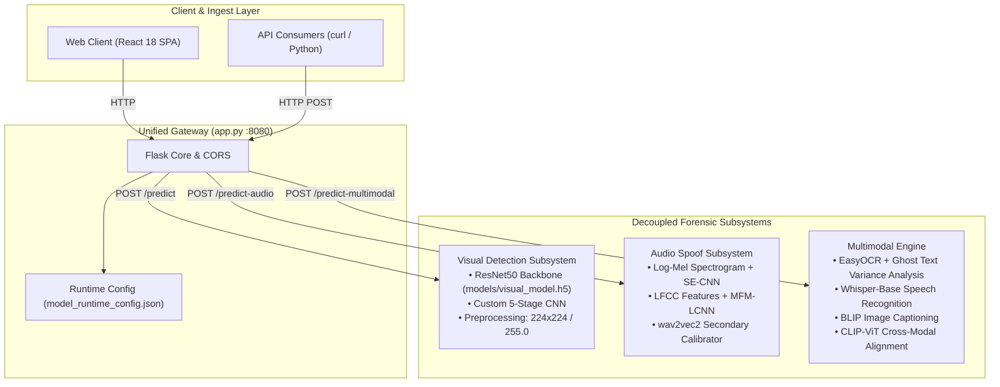
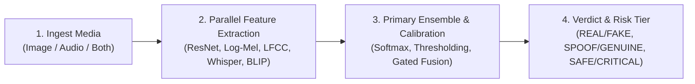

# Guardian AI

**Multimodal Deepfake, Voice Spoofing, and Cross-Modal Manipulation Forensics**

[](https://www.python.org/downloads/release/python-31013/)
[](https://flask.palletsprojects.com/)
[](https://www.tensorflow.org/)
[](https://pytorch.org/)
[](docs/README.md)

---

## What is Guardian AI?

**Guardian AI** is an open-source, multi-pipeline forensic detection system engineered to identify synthetic media, neural voice cloning, and multimodal prompt injection attacks. Rather than treating synthetic media as a monolithic problem, Guardian AI partitions forensic analysis across three specialized subsystems:
1. **Visual Forensic Pipeline**: Detects facial manipulation, synthetic face generation (StyleGAN, Diffusion), and blending artifacts in portrait images.
2. **Acoustic Anti-Spoof Pipeline**: Identifies synthetic speech, neural Text-to-Speech (TTS), and voice conversion (VC) artifacts in raw audio recordings.
3. **Multimodal Injection & Cross-Modal Consistency Engine**: Detects adversarial prompt injection attempts (embedded ghost text), visual-textual discrepancies, and audio-visual contradictions in compound media.

Guardian AI exposes simple HTTP endpoints for inference and serves an interactive, zero-build web interface.

---

## System Architecture



---

## Key Features

- **Decoupled Multimodal Triage**: Analyze an image alone, an audio file alone, or both simultaneously without forced dummy inputs.
- **Dual-Stream Acoustic Anti-Spoofing**: Combines psychoacoustic Log-Mel spectrograms (SE-CNN) with linear-frequency LFCC representations (MFM-LCNN) for sub-50ms CPU voice spoof detection.
- **Adversarial Prompt Injection Defense**: Scans images for low-contrast "ghost" text, decodes visual text via EasyOCR, and detects jailbreak phrases using fuzzy matching.
- **Cross-Modal Narrative Consistency**: Cross-references spoken audio transcripts (Whisper) against visual scene captions (BLIP) and visual embeddings (CLIP) to catch audio-visual disinformation.
- **Auditable Signal Breakdown**: Multimodal outputs return transparent weighted scores across each contributing detector for full forensic accountability.
- **Zero-Build Web UI**: Built with React 18, Google Fonts, and a glassmorphic cyber-forensic dark mode served directly from the backend.
- **Cloud-Ready Infrastructure**: Includes production Render Blueprint (`render.yaml`) and multi-threaded Gunicorn serving profiles.

---

## How It Works in 4 Steps



1. **Ingest & Normalize**: Uploaded media is ingested into RAM (`/predict`) or short-lived temporary files (`/predict-audio`, `/predict-multimodal`). Images are standardized to $224 \times 224$ RGB tensors; audio is resampled to $16\text{ kHz}$ mono.
2. **Feature Extraction**:
   - Visual: Scaled pixel arrays passed through a 181-layer ResNet50 convolutional backbone.
   - Acoustic: Extracted into 80-bin Log-Mel and 60-coefficient LFCC feature planes.
   - Multimodal: Extracted via EasyOCR, Whisper ASR, and BLIP captioning.
3. **Forensic Scoring**:
   - Visual pipeline outputs sigmoid probability $\hat{y}$ evaluated against the calibrated threshold ($\tau = 0.01$).
   - Acoustic pipeline combines SE-CNN and MFM-LCNN models ($0.55 / 0.45$), smoothed by a wav2vec2 calibrator.
   - Multimodal engine executes from-scratch TF-IDF/Jaccard text similarity and fuzzy keyword matching.
4. **Output Generation**: Structured JSON returns the classification verdict, confidence percentage, raw score, risk tier, and human-readable explanation. Ephemeral temporary files are unlinked immediately.

---

## Verified Benchmark Results

The following results were audited directly from recorded execution outputs in the repository's Jupyter notebooks (`.ipynb` output streams):

| Model Architecture | Task / Dataset | Test Split Size | Accuracy | Precision (Fake / Real) | Recall (Fake / Real) | ROC AUC | Average Precision | Verified Source |
| :--- | :--- | :--- | :--- | :--- | :--- | :--- | :--- | :--- |
| **Custom 5-Stage CNN** | Visual Deepfakes (140k Faces) | 20,000 images | **95.0%** | **0.92 / 0.99** | **0.99 / 0.92** | **0.9956** | **0.9954** | `Model/DeepFake-CNN-Custom.ipynb` |
| **DenseNet-121** | Visual Deepfakes (140k Faces) | 20,000 images | **92.0%** | **1.00 / 0.86** | **0.83 / 1.00** | **0.9924** | **0.9915** | `densenet.ipynb` |
| **VGGFace16** | Visual Deepfakes (140k Faces) | 21,591 images | **95.0%** | **0.97 / 0.93** | **0.92 / 0.97** | **0.9601** | **0.9326** | `vggface (2).ipynb` |
| **Custom CNN (10 Ep)** | Visual Deepfakes (140k Faces) | 20,000 images | **91.0%** | **0.87 / 0.97** | **0.97 / 0.85** | **0.9858** | **0.9852** | `custom_cnn (2).ipynb` |

*For full classification reports and confusion matrices, see [Evaluation Results](docs/evaluation/results.md).*

---

## User Interface

```
+-----------------------------------------------------------------------------------------+
|  Guardian AI                          Analyser   Features                               |
|                                                                                         |
|  [Audio]   [Image]   [Multimodal]                                                       |
|  +-------------------------------------+---------------------------------------------+  |
|  | Scene & Visual Intelligence         |   +-------------------------------------+   |  |
|  | Upload an image to extract visual   |   |        Drop image file here         |   |  |
|  | descriptions and detect deepfakes.  |   |    or click to browse (JPG, PNG)    |   |  |
|  |                                     |   +-------------------------------------+   |  |
|  |  [✓] Scene understanding            |   [       Analyse Image  ->       ]         |  |
|  |  [✓] Object & artifact detection    |                                             |  |
|  +-------------------------------------+---------------------------------------------+  |
+-----------------------------------------------------------------------------------------+
```
*(Interactive web UI accessible at `http://127.0.0.1:8080/` when running `app.py`)*

---

## Quickstart

### 1. Installation
Requires **Python 3.10.x** (pinned to `3.10.13`):

```bash
# Clone the repository
git clone git@github.com:anchit-goel/Guardian-AI.git
cd Guardian-AI

# Create virtual environment
python3.10 -m venv .venv
source .venv/bin/activate  # On Windows: .venv\Scripts\activate

# Install dependencies
pip install --upgrade pip
pip install -r requirements.txt
```

### 2. Launch the Application
```bash
python app.py
```
Open `http://127.0.0.1:8080/` in your browser.

### 3. Run Inference via curl

**Visual Detection:**
```bash
curl -X POST http://127.0.0.1:8080/predict \
  -F "image=@modules/multimodal_injection/test_image.jpg"
```

**Audio Spoof Detection:**
```bash
curl -X POST http://127.0.0.1:8080/predict-audio \
  -F "audio=@modules/audio_spoof_system/wav samples/bonafide1.wav"
```

**Multimodal Cross-Modal Analysis:**
```bash
curl -X POST http://127.0.0.1:8080/predict-multimodal \
  -F "image=@modules/multimodal_injection/test_injection_image.jpg"
```

---

## Technology Stack

| Layer | Technologies Used | Purpose |
| :--- | :--- | :--- |
| **Serving Gateway** | Flask, Flask-CORS, Gunicorn (22.0.0) | REST API, static asset hosting, reverse proxy integration |
| **Alternative Service** | FastAPI, Uvicorn | Dedicated multimodal injection microservice (`main.py :8001`) |
| **Visual Models** | TensorFlow 2.16.2, Keras, Pillow | ResNet50 and Custom CNN inference and image scaling |
| **Audio Models** | PyTorch, Torchaudio, Librosa, Soundfile | Log-Mel & LFCC extraction, SE-CNN & MFM-LCNN models |
| **Multimodal Sensors** | Transformers, Hugging Face Hub, EasyOCR, RapidFuzz | Whisper (ASR), BLIP (Captioning), CLIP (Alignment), OCR |
| **Frontend UI** | HTML5, Vanilla CSS, React 18, Babel Standalone | Zero-build interactive dark-mode single page application |
| **Cloud Hosting** | Render Blueprint (`render.yaml`) | Production container deployment with Python 3.10 pin |

---

## Repository Structure

```text
GuardianAI/
├── app.py                          # Primary Flask gateway and REST API endpoints
├── index.html                      # React 18 Single Page Application
├── style.css                       # Dark-mode glassmorphic design system
├── model_runtime_config.json       # Visual pipeline runtime configuration & threshold
├── requirements.txt                # Pinned production Python dependencies
├── render.yaml                     # Render Blueprint infrastructure-as-code
├── runtime.txt                     # Python runtime version pin (python-3.10.13)
│
├── models/                         # Serialized visual model weights
│   ├── visual_model.h5             # ResNet50 production weights (290 MB)
│   └── new_model.h5                # Alternative ResNet50 checkpoint (97 MB)
│
├── modules/
│   ├── audio_spoof_system/         # Standalone audio anti-spoofing subsystem
│   │   ├── inference.py            # Audio inference & calibration logic
│   │   ├── models_architecture.py  # SE-CNN and MFM-LCNN PyTorch definitions
│   │   ├── pretrained_detector.py  # Secondary wav2vec2 calibrator pipeline
│   │   ├── test_runner.py          # Batch evaluation test runner
│   │   └── models/                 # Saved PyTorch checkpoints (.pth)
│   │
│   └── multimodal_injection/       # Standalone multimodal injection subsystem
│       ├── main.py                 # FastAPI microservice entry point
│       ├── multimodal_detector.py  # Core ghost text, OCR, Whisper, BLIP, CLIP logic
│       ├── generate_test_samples.py# Synthetic test asset generator
│       └── test_models.py          # Functional test suite
│
├── scripts/                        # Utility & calibration scripts
│   ├── calibrate_threshold.py      # Grid-search threshold optimizer for F1-score
│   ├── generate_scores_local.py    # Local high-throughput batch directory scorer
│   └── generate_scores_csv.py      # Remote API score generator
│
└── docs/                           # Comprehensive documentation suite
    ├── README.md                   # Documentation index
    ├── getting-started/            # Installation, configuration, troubleshooting
    ├── concepts/                   # Overview, detection mechanics, responsible use
    ├── models/                     # Model cards, image detector, audio detector, inference
    ├── data/                       # Dataset cards, preprocessing & augmentations
    ├── training/                   # Training guide, experiments & run logs
    ├── evaluation/                 # Verified results, methodology, limitations
    ├── architecture/               # System overview, backend, frontend, deployment, ADRs
    ├── api/                        # API overview & endpoint reference
    ├── guides/                     # Practical detection & fine-tuning guides
    ├── project/                    # Roadmap, FAQ, academic references
    ├── assets/                     # Architecture diagrams and evaluation plots
    └── CHANGELOG-DOCS.md           # Documentation audit & migration changelog
```

---

## Documentation Quick Links

- [Documentation Index](docs/README.md)
- [Model Cards](docs/models/model-cards.md)
- [Dataset Cards](docs/data/datasets.md)
- [API Reference](docs/api/reference.md)
- [Architecture Decision Records (ADRs)](docs/architecture/decisions/ADR-0001-separate-image-audio-multimodal-pipelines.md)
- [Documentation Audit & Code Discrepancies](docs/CHANGELOG-DOCS.md)

---

## Responsible Use & Ethical Disclaimer

> [!WARNING]
> **Important Ethical & Operational Notice**:  
> Guardian AI is designed as an investigative triage tool for content moderation and security analysis. It is **not** an infallible legal or forensic proof system. Automated scores should **never** be used as the sole basis for legal sanctions, account termination, or public accusations without human review. For full ethical boundaries, see [Responsible Use](docs/concepts/responsible-use.md).

---

## Contributing

We welcome community contributions, additional modality detectors, and benchmark evaluations. Please review [CONTRIBUTING.md](CONTRIBUTING.md) for development environment setup, coding guidelines, and pull request workflows.

---

## Security Policy

For vulnerability reporting protocols and responsible disclosure procedures, please consult [SECURITY.md](SECURITY.md).

---

## License

*(Audit Note: The repository does not currently include a formal `LICENSE` file. An open-source license will be selected by the project maintainers. See [Documentation Audit](docs/CHANGELOG-DOCS.md) for details.)*

---

## Citations & Acknowledgements

If you use Guardian AI in your research or applications, please cite the underlying architectures and datasets documented in [Academic References](docs/project/references.md):
- **140k Real & Fake Faces Dataset** (Nvidia FFHQ & Facebook DFDC 1M Fake Faces contributions via Kaggle).
- **Deep Voice Dataset** (Kaggle birdy654).
- **OpenAI Whisper & CLIP**, **Salesforce BLIP**, **JaidedAI EasyOCR**.
- **ResNet50**, **DenseNet-121**, **VGGFace**, and **Light CNN (LCNN)** architectures.

---

## Maintainers & Project Origin

Guardian AI was prepared and developed as part of the **HACK IITK 2026 Grand Finale**.

### Project Maintainers
- **Anchit Goel**
- **Malhar Srivatsav**
- **Ryan Gupta**

