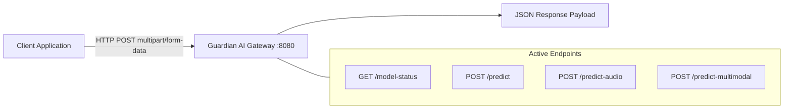

# API: Overview & Design Principles

> In this page: REST API design principles, authentication, media transport conventions (multipart/form-data), status code taxonomy, and CORS policies.  
> Who it's for: API developers, systems integrators, and client library authors.

---

## API Architecture

Guardian AI exposes a standard HTTP/1.1 REST API designed for ease of integration across programming languages and workflow orchestrators.

---

## Base URLs

- **Local Development**: `http://127.0.0.1:8080` (or `http://localhost:8080`)
- **Docker / Production Server**: `http://<your-host-or-domain>:8080` (or dynamically mapped `$PORT`)

---

## Transport Protocol & Media Encoding

All media submission endpoints use standard **`multipart/form-data`** encoding rather than raw JSON or Base64 payloads:
- **Binary Streaming**: Uploading binary media directly via `multipart/form-data` eliminates the $\sim 33\%$ payload bandwidth penalty of Base64 encoding.
- **Form-Data Field Keys**:
  - `image`: Uploaded image binary (`image/jpeg`, `image/png`, `image/webp`, `image/bmp`).
  - `audio`: Uploaded audio binary (`audio/wav`, `audio/mpeg`, `audio/ogg`, `audio/flac`, `audio/x-m4a`).

---

## HTTP Status Codes

The API returns standard RFC-compliant HTTP status codes:

| Status Code | Meaning | Typical Trigger |
| :--- | :--- | :--- |
| **`200 OK`** | Success | Inference completed normally; JSON payload returned. |
| **`400 Bad Request`** | Client Error | Missing required form-data key (`image` or `audio`), empty filename, or unsupported file type. |
| **`500 Internal Server Error`** | Server / Inference Error | Model failed to load, corrupt image/audio headers, or unhandled runtime exception. |
| **`503 Service Unavailable`** | Background Loading | Multimodal transformer models (Whisper, BLIP, CLIP) are still warming up in the background. |

---

## Cross-Origin Resource Sharing (CORS)

- **Unified Gateway (`app.py`)**: Configured with `CORS(app)` allowing unrestricted cross-origin requests for web client flexibility.
- **Dedicated Microservice (`main.py`)**: Configured with `CORSMiddleware(allow_origins=[...])`, which should be updated with your production frontend domain in production deployments.
