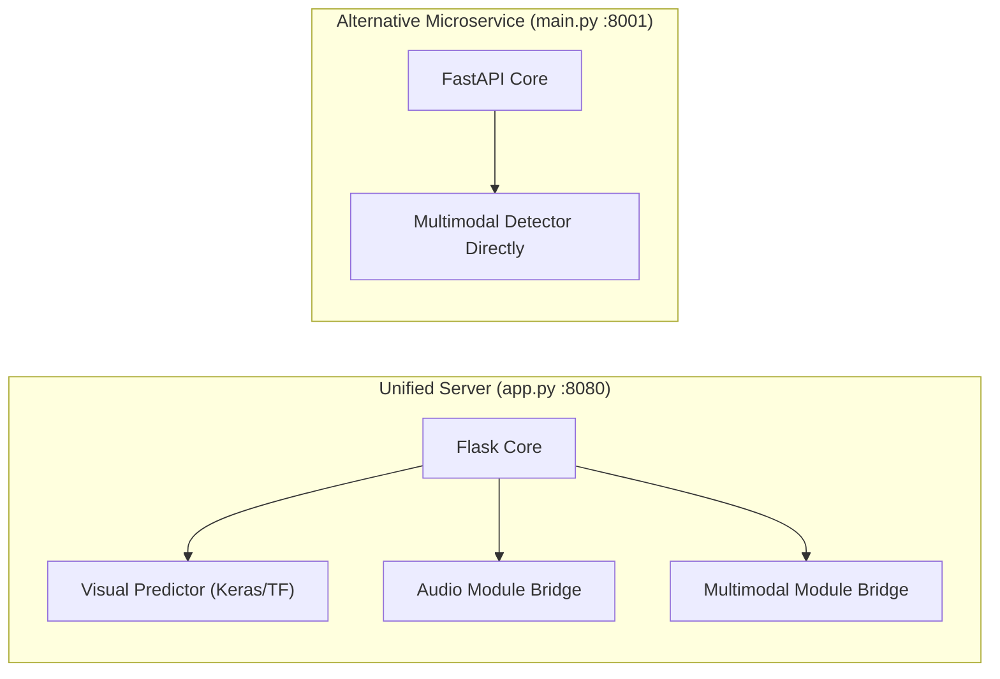

# Architecture: Backend & API Service

> In this page: Structure of the Flask gateway and FastAPI microservice, model discovery, robust weight loading, lifecycle hooks, and error handling.  
> Who it's for: Backend engineers, API integrators, and infrastructure teams.

---

## Backend Services Overview

Guardian AI provides two backend service entry points:
1. **Primary Unified Gateway (`app.py`)**: A production-ready Flask server exposing the complete multimodal suite (`/predict`, `/predict-audio`, `/predict-multimodal`, `/model-status`) and serving the frontend Single Page Application on port `8080`.
2. **Dedicated Multimodal Microservice (`modules/multimodal_injection/main.py`)**: An independent FastAPI application dedicated exclusively to multimodal prompt injection detection on port `8001`.



---

## 1. Unified Flask Gateway (`app.py`)

### Model Discovery & Configuration
When `app.py` initializes:
1. It locates `model_runtime_config.json` via the `MODEL_CONFIG_PATH` environment variable (falling back to workspace root).
2. It parses runtime preferences:
   ```json
   {
     "selected_model": "models/visual_model.h5",
     "allow_demo_model": true,
     "preprocess_mode": "rescale_255",
     "threshold": 0.01,
     "positive_label": "REAL",
     "negative_label": "FAKE",
     "input_size": [224, 224]
   }
   ```
3. If `selected_model` is not set or missing, `discover_models()` recursively scans the workspace for `.h5` and `.keras` files, ignoring `.venv/` paths and sorting by modification timestamp (`st_mtime`).
4. If no model file exists and `allow_demo_model` is `true`, `write_demo_classifier()` compiles and saves a tiny placeholder network (`models/results/_demo_classifier.keras`) so that the HTTP API remains operational during initial environment validation.

### Robust HDF5 Model Loading
Keras versions frequently encounter breaking schema changes across major releases (e.g. Keras 2 vs Keras 3 `groups` argument in `DepthwiseConv2D`). Guardian AI implements a two-stage robust loader in `load_model_robust()`:
1. **Direct Keras Load**: Attempts standard `tf.keras.models.load_model(compile=False)` with a custom `CompatibleDepthwiseConv2D` layer that strips incompatible `groups` configuration keys.
2. **Attribute Inspection Fallback**: If standard loading fails, it opens the HDF5 binary via `h5py.File`, extracts the embedded `model_config` JSON string, recursively purges unsupported layer attributes, reconstructs the topology via `model_from_json()`, and loads weights directly with `load_weights()`.

### Asynchronous Background Loading
Heavy transformers (Whisper, BLIP, CLIP) require substantial memory and network/disk initialization time. To ensure that the web server passes cloud platform health checks immediately upon boot:
- `start_multimodal_background_load()` initiates a background daemon thread during startup.
- The thread initializes EasyOCR, Whisper, BLIP, and CLIP models in the background.
- If a client calls `POST /predict-multimodal` while models are still loading, the server returns an informative `503 Service Unavailable` with message: `"Multimodal model is still loading. Please try again in a minute."`

---

## 2. API Endpoints & Contract

| Route | Method | Content-Type | Payload Keys | Description | Status Codes |
| :--- | :--- | :--- | :--- | :--- | :--- |
| `/` | `GET` | `text/html` | None | Serves the single-page web UI | 200 |
| `/style.css` | `GET` | `text/css` | None | Serves the web UI stylesheet | 200 |
| `/model-status`| `GET` | `application/json`| None | Diagnostics for visual, audio, and multimodal subsystems | 200 |
| `/predict` | `POST` | `multipart/form-data` | `image` | Evaluates facial image for deepfake manipulation | 200, 400, 500 |
| `/predict-audio` | `POST` | `multipart/form-data` | `audio` | Evaluates speech recording for synthetic spoofing | 200, 400, 500 |
| `/predict-multimodal`| `POST` | `multipart/form-data` | `image` and/or `audio` | Comprehensive cross-modal and prompt injection analysis | 200, 400, 500, 503 |

For complete request and response schema examples, see the [API Reference](../api/reference.md).

---

## 3. Dedicated Multimodal Microservice (`main.py`)

Located in `modules/multimodal_injection/main.py`, this service offers a FastAPI alternative suited for containerized microservice architectures.

### Architecture Highlights:
- **Framework**: FastAPI with automatic OpenAPI docs (`/docs`).
- **CORS Middleware**: Configured with explicit origin allowances (`allow_origins=["https://your-frontend-domain.com"]`).
- **Endpoints**:
  - `POST /detect/image`: Direct image injection detection.
  - `POST /detect/audio`: Direct audio injection detection.
  - `POST /detect/multimodal`: Compound cross-modal detection.
  - `GET /health`: Microservice liveness probe returning `{"status": "running", "system": "multimodal injection detector"}`.
- **Execution Command**:
  ```bash
  uvicorn main:app --reload --host 0.0.0.0 --port 8001
  ```
