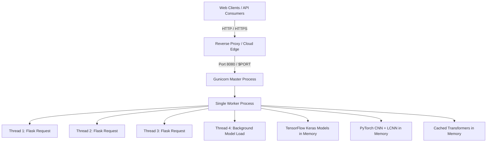

# Architecture: Deployment & Serving

> In this page: Production serving configuration, Gunicorn setup, cloud hosting via Render Blueprint (`render.yaml`), worker and threading strategies, environment variables, and cache management.  
> Who it's for: DevOps engineers, SREs, and deployment teams.

---

## Production Serving Architecture

In production environments, Guardian AI is served using **Gunicorn** (WSGI HTTP Server) wrapping the Flask gateway:



---

## 1. Cloud Deployment via Render Blueprint

The repository contains a fully defined infrastructure-as-code specification in `render.yaml`.

### Render Blueprint Configuration
```yaml
services:
  - type: web
    name: guardianai
    env: python
    plan: standard
    autoDeploy: true
    rootDir: .
    buildCommand: pip install --upgrade pip && pip install -r requirements.txt
    startCommand: gunicorn app:app --bind 0.0.0.0:$PORT --workers 1 --threads 4 --timeout 900
    healthCheckPath: /
    envVars:
      - key: PYTHON_VERSION
        value: 3.10.13
      - key: HOST
        value: 0.0.0.0
      - key: MODEL_CONFIG_PATH
        value: /opt/render/project/src/model_runtime_config.json
      - key: TRANSFORMERS_CACHE
        value: /opt/render/project/.cache/huggingface
      - key: HF_HOME
        value: /opt/render/project/.cache/huggingface
```

### Critical Serving Constraints Explained

#### Why `--workers 1` and `--threads 4`?
Machine learning frameworks (TensorFlow, PyTorch, CUDA runtime) require substantial RAM. Spawning multiple process workers (`--workers > 1`) duplicates all model weights in RAM (forking multiple instances of Whisper, BLIP, CLIP, and ResNet50), leading to immediate Out-Of-Memory (`OOMKilled`) termination on cloud instances with limited memory. Using a single worker with multiple threads shares model weights across concurrent requests.

#### Why `--timeout 900`?
The first request to multimodal or audio endpoints often involves downloading transformer checkpoints from Hugging Face or warming up computation graphs. Setting a $900$-second ($15$-minute) worker timeout prevents Gunicorn from prematurely killing the worker during model warm-up.

#### Persistent Cache Directories
`TRANSFORMERS_CACHE` and `HF_HOME` are explicitly pinned to `/opt/render/project/.cache/huggingface` so that downloaded weights persist across server restarts where persistent disk is available.

---

## 2. Deploying on Render: Step-by-Step

1. Push your repository to GitHub.
2. In the [Render Dashboard](https://dashboard.render.com), click **New +** and select **Blueprint**.
3. Connect your GitHub repository and select the target branch.
4. Render will parse `render.yaml` automatically.
5. Review the plan settings (a minimum of 2GB RAM is required for visual + audio; 4GB+ RAM recommended if running full multimodal Whisper/BLIP).
6. Click **Apply**.

---

## 3. Local Production Serving with Gunicorn

To run the production Gunicorn server locally (macOS/Linux):

```bash
# Activate your environment
source .venv/bin/activate

# Execute Gunicorn matching render.yaml parameters
gunicorn app:app --bind 0.0.0.0:8080 --workers 1 --threads 4 --timeout 900
```

---

## 4. Windows Execution Scripts

For developers working locally on Windows, the repository provides pre-configured convenience scripts:
- `run.ps1`: PowerShell startup script.
- `run_flask_venv.bat`: Batch script that activates `.venv\Scripts\python.exe` and runs `app.py`.
- `xrun_flask_venv.bat` & `xcheck_venv_python.bat`: Diagnostic batch utilities to verify virtualenv Python interpreter paths.
