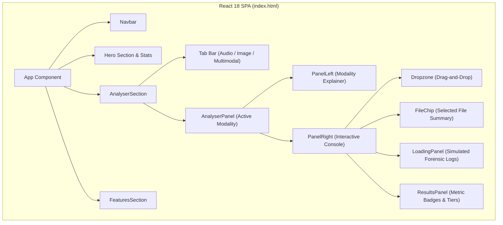
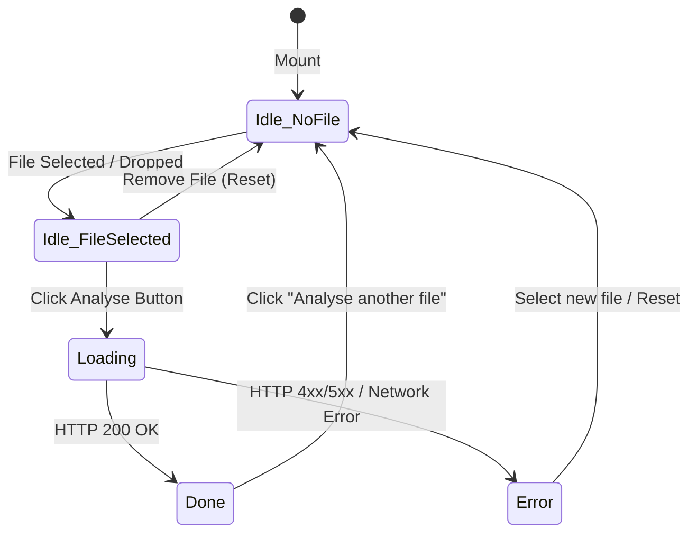

# Architecture: Frontend Web Application

> In this page: Architecture of the single-page browser interface, component tree, UI state management, styling design system, and API integration.  
> Who it's for: Frontend engineers, UI/UX designers, and full-stack contributors.

---

## Frontend Architecture Overview

The Guardian AI frontend (`index.html`, `style.css`) is a lightweight, zero-build Single Page Application (SPA) served directly from the root of the Flask gateway at `http://127.0.0.1:8080/`.

---

## Technology Stack

- **Runtime Engine**: React 18 (loaded via unpkg CDN: `react.development.js`, `react-dom.development.js`).
- **JSX Compilation**: In-browser transformation via Babel Standalone (`@babel/standalone`).
- **Styling**: Vanilla CSS (`style.css`) using CSS custom properties (variables), flexible grid and flexbox layouts, glassmorphic backdrop filters, and CSS keyframe animations.
- **Typography**: Inter (UI copy) and JetBrains Mono (timestamps, raw scores, and confidence badges) via Google Fonts.
- **Zero Build Step**: Requires no `npm install`, Webpack, Vite, or bundle compilation. The file can be modified and refreshed instantly in any browser.

---

## Component Breakdown

### 1. `Navbar`
Displays branding and anchor navigation links (`#analyser`, `#features`).

### 2. `Hero`
Presents the project tagline, primary call-to-actions, and high-level platform statistics:
- **Accuracy**: $99.2\%$ transcription accuracy (Whisper-grade benchmark).
- **Processing Time**: $< 3\text{s}$ average processing time on CPU/GPU.
- **File Formats**: Support for $12$ common audio and image extensions.

### 3. `AnalyserSection` & `AnalyserPanel`
The central interactive console. Users switch between three modality tabs:
- **Audio Tab (`id: "audio"`)**: Accepts `.mp3, .wav, .ogg, .m4a, .flac`. Routes inference to `POST /predict-audio`.
- **Image Tab (`id: "video"`)**: Accepts `.jpg, .jpeg, .png, .webp, .bmp`. Routes inference to `POST /predict`.
- **Multimodal Tab (`id: "multimodal"`)**: Renders a side-by-side dual dropzone for image and audio. Routes to `POST /predict-multimodal`.

### 4. Interactive Console States
The `AnalyserPanel` cycles through four deterministic states:

- **`idle` (no file)**: Displays `Dropzone` encouraging drag-and-drop or file browsing.
- **`idle` (file selected)**: Displays `FileChip` showing file name, human-readable file size (KB/MB), and an action button (`Analyse Image`, `Analyse Audio`, or `Run Multimodal Analysis`).
- **`loading`**: Displays an animated CSS spinner, animated loading ellipsis, and forensic log diagnostics (e.g. `> Preprocessing audio stream...`, `> Extracting features...`).
- **`done`**: Displays `ResultsPanel` with execution time (`Done in 0.42s`), prediction verdict, confidence percentage, raw score, risk tier badge, and human-readable explanation.
- **`error`**: Surfaces server error messages or network failure notices (e.g., advising the user to verify that `app.py` is running).

---

## Design System & Aesthetics

Guardian AI incorporates a sleek, cyber-forensic dark-mode design system defined in `style.css`:
- **Palette**: Deep slate backgrounds (`#090D16`, `#0D1322`), subtle translucent borders (`rgba(255, 255, 255, 0.08)`), and vibrant status accents:
  - Primary / Audio: Teal (`#14B8A6`, `#0F766E`)
  - Image: Sky Blue (`#0EA5E9`)
  - Multimodal: Cyan (`#06B6D4`)
  - Error: Red (`#EF4444`)
- **Glassmorphism**: Panels utilize backdrop blurs (`backdrop-filter: blur(16px)`) with semi-transparent gradients.
- **Ambient Canvas**: Background layers render subtle fixed dot grids and radial glow overlays.
