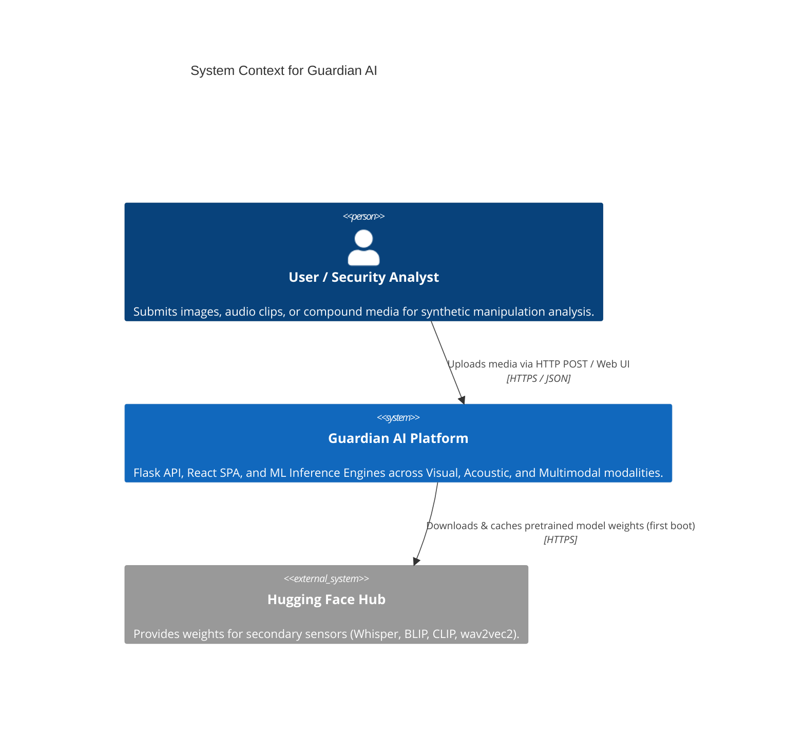
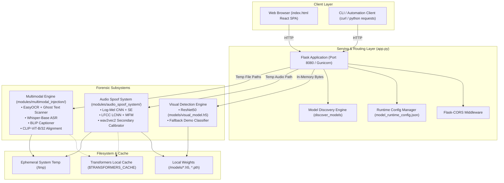
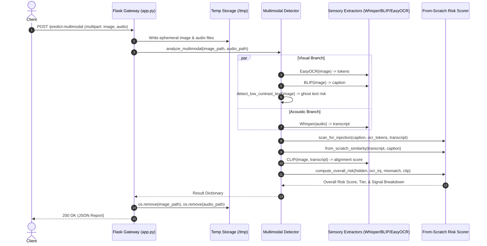

# Architecture: System Overview

> In this page: System context, component architecture, data flow paths, sequence flows, and cross-modal decision boundaries.  
> Who it's for: Systems architects, backend developers, and DevOps engineers.

---

## System Context Diagram

Guardian AI acts as a unified media forensics gateway. Clients interact via an HTTP REST API or a browser-based Single Page Application (SPA).

---

## Container & Component Diagram

The repository is organized into three primary operational tiers: the Web Serving Layer, the Specialized Model Execution Modules, and the Local Model Cache.

---

## Sequence Diagram: Detection Request Lifecycle

The diagram below details the execution lifecycle when handling an audio-visual compound request to `POST /predict-multimodal`:

---

## Key Architectural Principles

1. **Decoupled Forensic Modules**: The visual, audio, and multimodal subsystems reside in isolated packages. The visual pipeline runs entirely on TensorFlow/Keras, while the audio and multimodal pipelines run on PyTorch and Hugging Face Transformers.
2. **Graceful Degradation**:
   - If heavyweight visual weights are missing, the server can generate an untrained demo classifier (`_demo_classifier.keras`) to maintain API responsiveness for local UI development if `allow_demo_model` is enabled.
   - If the audio transformer calibrator (`wav2vec2`) fails to download or runs out of memory, the audio engine automatically falls back to the primary scratch-built CNN + LCNN ensemble (`mode: primary_only`).
   - The multimodal engine loads asynchronously on a background thread during application startup (`start_multimodal_background_load()`) to prevent blocking port binding and avoid deploy timeouts on platforms like Render.
3. **Stateless Media Lifecycle**: Media is processed in-memory or written to short-lived temporary files that are guaranteed to be unlinked in `finally` clauses. No media files or biometric embeddings are persisted to disk.
