# Concepts: How Detection Works

> In this page: End-to-end detection pipelines for image, audio, and compound media, mathematical formulations, score aggregation, calibration logic, and threshold decisions.  
> Who it's for: ML practitioners, backend developers, and forensic evaluators.

---

## High-Level Pipeline Architecture

Guardian AI operates three distinct, decoupled forensic pipelines that can be invoked individually or together depending on the incoming media format:

```mermaid
flowchart TB
    subgraph Visual_Pipeline ["1. Visual Pipeline (POST /predict)"]
        ImgIn[Input Image] --> ImgResize[Resize to 224x224 & RGB]
        ImgResize --> ImgNorm["Normalization: / 255.0"]
        ImgNorm --> ResNet[ResNet50 Backbone + Dense Head]
        ResNet --> VisSigmoid["Sigmoid Output: raw_score ∈ [0, 1]"]
        VisSigmoid --> VisThreshold{"raw_score > threshold (default 0.01)"}
        VisThreshold -->|Yes| VisReal["Label: REAL\nConfidence = raw_score * 100%"]
        VisThreshold -->|No| VisFake["Label: FAKE\nConfidence = (1 - raw_score) * 100%"]
    end

    subgraph Audio_Pipeline ["2. Acoustic Pipeline (POST /predict-audio)"]
        AudIn[Input Audio] --> AudSample[Resample 16kHz Mono]
        AudSample --> MelExt["Log-Mel Spectrogram\n(80 mels, n_fft=400, hop=160)"]
        AudSample --> LFCCExt["LFCC Features\n(60 coeffs, n_fft=512, hop=160)"]
        MelExt --> AudCNN[Custom CNN with Squeeze-and-Excitation]
        LFCCExt --> AudLCNN[LCNN with Max-Feature-Map]
        AudCNN --> CNNProb["CNN Spoof Prob (Softmax)"]
        AudLCNN --> LCNNProb["LCNN Spoof Prob (Softmax)"]
        CNNProb & LCNNProb --> BaseScore["base_score = 0.55*CNN + 0.45*LCNN"]
        AudSample -.-> Calibrator["Secondary Calibrator:\nwav2vec2-large-xlsr"]
        Calibrator -.-> CalibScore[Calibrator Spoof Prob]
        BaseScore & CalibScore --> CalibFusion["Disagreement-Aware Calibration Fusion"]
        CalibFusion --> AudSoften[Extreme Softening]
        AudSoften --> AudVerdict["Verdict: SPOOF (>=0.5) / GENUINE (<0.5)\nRisk Tier: LOW / MEDIUM / HIGH / CRITICAL"]
    end

    subgraph Multimodal_Pipeline ["3. Multimodal Pipeline (POST /predict-multimodal)"]
        MultiIn[Compound Image & Audio] --> BranchImg[Image] & BranchAud[Audio]
        BranchImg --> LowContrast["Pixel Variance Block Analysis (Ghost Text)"]
        BranchImg --> BLIP["BLIP Image Captioning"]
        BranchImg --> OCR["EasyOCR Character Extraction"]
        BranchAud --> Whisper["Whisper-Base Speech-to-Text"]
        OCR & BLIP & Whisper --> InjectScanner["Injection Keyword Scanner (Exact + Fuzzy)"]
        Whisper & BLIP --> TextSim["From-Scratch Semantic Similarity (TF-IDF + Jaccard)"]
        BranchImg & Whisper --> CLIP["CLIP Cross-Modal Alignment"]
        LowContrast --> WSum["Weighted Risk Fusion:\n0.15*Hidden + 0.35*OCR_Inj + 0.30*Mismatch + 0.20*CLIP"]
        InjectScanner --> WSum
        TextSim --> WSum
        CLIP --> WSum
        WSum --> MultiVerdict["Overall Risk Score & Tier\nSAFE / SUSPICIOUS / HIGH RISK / CRITICAL"]
    end
```

---

## 1. Visual Detection Pipeline

The visual forensic pipeline (`app.py`) is designed for static facial and portrait image classification.

### Preprocessing & Normalization
1. **Format Handling**: Incoming image bytes are loaded via Pillow (`Image.open(BytesIO(image_bytes)).convert("RGB")`).
2. **Resizing**: Images are bilinearly interpolated to the target dimensions defined in `model_runtime_config.json` (default `[224, 224]`).
3. **Array Conversion**: Converted to single-precision floating point tensors of shape `(1, 224, 224, 3)`.
4. **Rescaling**: By default, pixel intensities in $[0, 255]$ are normalized by dividing by $255.0$ to yield float values in $[0.0, 1.0]$. If configured for specific backbones, `preprocess_input` routines from `tf.keras.applications` can be applied.

### Network Execution
The production model (`models/visual_model.h5` / `models/new_model.h5`) uses a 181-layer ResNet50 backbone topped by an average pooling layer and dense classification head:
$$\mathbf{z} = \text{Dense}_{1}(\text{Dropout}_{0.3}(\text{Dense}_{128}(\text{Dropout}_{0.5}(\text{Dense}_{256}(\text{GAP}(\mathbf{F}_{conv}))))))$$
$$\hat{y} = \sigma(\mathbf{z}) \in (0, 1)$$

### Verdict and Confidence Computation
In `app.py`, the model outputs a scalar probability $\hat{y}$ (`raw_score`):
- If $\hat{y} > \tau$ (where threshold $\tau$ is set in `model_runtime_config.json`, calibrated to $0.01$):
  $$\text{Label} = \text{POSITIVE\_LABEL} \ (\text{"REAL"}), \quad \text{Confidence} = \hat{y} \times 100\%$$
- If $\hat{y} \le \tau$:
  $$\text{Label} = \text{NEGATIVE\_LABEL} \ (\text{"FAKE"}), \quad \text{Confidence} = (1.0 - \hat{y}) \times 100\%$$

> [!NOTE]
> The calibrated threshold in `model_runtime_config.json` is set to `0.01`. This reflects a high-sensitivity operating point calibrated by `scripts/calibrate_threshold.py` to maximize detection recall on validation sets.

---

## 2. Acoustic Spoof Pipeline

The audio detection subsystem (`modules/audio_spoof_system/inference.py`) processes input speech to detect synthetic speech, TTS generators, and voice conversions.

### Audio Feature Extraction
Audio is loaded at a standardized $16\text{ kHz}$ mono sample rate (`librosa.load(audio_path, sr=16000, mono=True)`) and normalized. Two complementary acoustic representations are extracted:

1. **Log-Mel Spectrogram**:
   - Extracted using $80$ Mel filterbanks, FFT window length $N_{fft} = 400$, and hop length $H = 160$ ($10\text{ ms}$ step).
   - Converted to decibels ($10 \log_{10}(P)$) and normalized using standard z-score normalization:
     $$\mathbf{S}_{norm} = \frac{\mathbf{S} - \mu_{\mathbf{S}}}{\sigma_{\mathbf{S}} + 10^{-8}}$$
2. **Linear Frequency Cepstral Coefficients (LFCC)**:
   - Extracted using `torchaudio.transforms.LFCC` with $60$ coefficients, $N_{fft} = 512$, and hop length $H = 160$.
   - Z-score normalized across the time-frequency plane.

### Dual-Architecture Primary Ensemble
Guardian AI uses two distinct neural architectures designed to capture different spoofing artifacts:

- **CNN with Squeeze-and-Excitation (SE)**: 3 convolutional stages ($32 \to 64 \to 128$ filters) with Batch Normalization, Max Pooling, and a channel attention Squeeze-and-Excitation block (reduction ratio $r = 8$) operating on the Log-Mel spectrogram.
- **Light Convolutional Neural Network (LCNN)**: 8 convolutional layers with **Max-Feature-Map (MFM)** non-linear activations operating on the LFCC representation. The MFM activation splits channels $C$ into $C/2$ pairs and takes the element-wise maximum:
  $$\text{MFM}(\mathbf{x})_{c} = \max(\mathbf{x}_{c}, \mathbf{x}_{c + C/2})$$

Both models output 2-class logits over `[genuine, spoof]` and compute softmax probabilities:
$$P_{CNN} = \text{Softmax}(\mathbf{z}_{CNN})_1, \quad P_{LCNN} = \text{Softmax}(\mathbf{z}_{LCNN})_1$$

The base ensemble score is computed as:
$$S_{base} = 0.55 \cdot P_{CNN} + 0.45 \cdot P_{LCNN}$$

### Secondary Calibrator & Disagreement Gating
To prevent overconfidence, an optional secondary transformer model (`Gustking/wav2vec2-large-xlsr-deepfake-audio-classification`) acts as a calibrator. If available, calibration fuses scores based on disagreement magnitude $\Delta = |S_{base} - P_{calib}|$:

$$\text{Corrected Score} = \begin{cases} 
0.55 \cdot S_{base} + 0.45 \cdot P_{calib} & \text{if } \Delta \ge 0.70 \ (\text{Strong disagreement}) \\
0.65 \cdot S_{base} + 0.35 \cdot P_{calib} & \text{if } 0.35 \le \Delta < 0.70 \ (\text{Moderate disagreement}) \\
0.75 \cdot S_{base} + 0.25 \cdot P_{calib} & \text{if } \Delta < 0.35 \ (\text{Standard alignment})
\end{cases}$$

### Score Softening & Risk Tiers
To prevent synthetic metric collapse near $0.0$ or $1.0$, extreme probabilities are compressed:
$$S_{final} = \begin{cases} 
0.95 + 0.25 \cdot (S - 0.95) & \text{if } S > 0.95 \\
0.05 - 0.25 \cdot (0.05 - S) & \text{if } S < 0.05 \\
S & \text{otherwise}
\end{cases}$$

Risk tiers and final verdicts are mapped directly:
- **Verdict**: $\text{SPOOF}$ if $S_{final} \ge 0.50$; otherwise $\text{GENUINE}$.
- **Risk Tiers**:
  - $S_{final} < 0.30 \implies \mathbf{LOW}$
  - $0.30 \le S_{final} < 0.60 \implies \mathbf{MEDIUM}$
  - $0.60 \le S_{final} < 0.85 \implies \mathbf{HIGH}$
  - $S_{final} \ge 0.85 \implies \mathbf{CRITICAL}$

---

## 3. Multimodal Injection & Cross-Modal Consistency

The multimodal engine (`modules/multimodal_injection/multimodal_detector.py`) combines computer vision, speech recognition, natural language processing, and statistical analysis to detect adversarial prompt injections and cross-modal tampering.

### Pixel-Level Ghost Text Detection
Adversarial prompt injections in images often employ low-contrast text (e.g., light gray on white) to evade human perception while remaining legible to OCR algorithms. Guardian AI evaluates local standard deviations across non-overlapping $32 \times 32$ pixel tiles on the grayscale image:
- Blocks with $2 < \sigma_{block} < 30$ are marked as **suspicious low-contrast regions** (ghost text).
- Blocks with $30 \le \sigma_{block} < 80$ are marked as **embedded high-contrast text**.
- Hidden content risk is computed as:
  $$R_{hidden} = \min\left(\frac{N_{suspicious}}{N_{total} + 10^{-8}} \times 3.0, \ 1.0\right)$$

### OCR & Adversarial Keyword Scanning
EasyOCR extracts text tokens with confidence thresholds ($c \ge 0.4$). Extracted text and image captions are scanned against an adversarial catalog (18 keywords, e.g., `ignore previous`, `jailbreak`, `override`, `you are now`, `system prompt`) using both exact matching and sliding-window fuzzy string matching (`rapidfuzz.fuzz.ratio` $\ge 80$).
Risk is mapped incrementally based on matching keyword count:
- $\ge 3\text{ keywords} \implies R_{inj} = 1.00$
- $2\text{ keywords} \implies R_{inj} = 0.85$
- $1\text{ keyword} \implies R_{inj} = 0.65$
- $0\text{ keywords} \implies R_{inj} = 0.00$

### Cross-Modal Semantic Mismatch
When both image and audio files are provided:
1. **Audio Transcription**: `openai/whisper-base` transcribes the spoken speech.
2. **Visual Captioning**: `Salesforce/blip-image-captioning-base` generates a dense natural language summary of the visual scene.
3. **From-Scratch Text Similarity**: A combination of Jaccard token overlap and Term Frequency (TF) cosine similarity computes cross-modal semantic similarity:
   $$\text{Sim} = 0.40 \cdot \text{Jaccard}(T_{audio}, T_{image}) + 0.60 \cdot \text{CosineTF}(T_{audio}, T_{image})$$
4. **Mismatch Risk**:
   $$\text{Mismatch Risk} = \begin{cases} 
   0.05 \ (\mathbf{LOW}) & \text{if } \text{Sim} > 0.50 \\
   0.45 \ (\mathbf{MEDIUM}) & \text{if } 0.30 < \text{Sim} \le 0.50 \\
   0.75 \ (\mathbf{HIGH}) & \text{if } 0.15 < \text{Sim} \le 0.30 \\
   0.95 \ (\mathbf{CRITICAL}) & \text{if } \text{Sim} \le 0.15
   \end{cases}$$
5. **CLIP Alignment Check**: `openai/clip-vit-base-patch32` measures direct vision-language embedding alignment. A degenerate or empty transcript triggers an automated penalty ($R_{clip} = 0.50$).

### Weighted Signal Aggregation
The overall multimodal risk score is computed through transparent, auditable weighted linear aggregation:
$$R_{overall} = \frac{0.15 \cdot R_{hidden} + 0.35 \cdot R_{ocr\_inj} + 0.30 \cdot R_{mismatch} + 0.20 \cdot R_{clip}}{\sum w_i}$$

The final verdict reflects the aggregated score:
- $R_{overall} > 0.85 \implies \mathbf{CRITICAL\ —\ injection\ attack\ detected}$
- $0.60 < R_{overall} \le 0.85 \implies \mathbf{HIGH\ RISK\ —\ likely\ manipulation}$
- $0.35 < R_{overall} \le 0.60 \implies \mathbf{SUSPICIOUS\ —\ review\ required}$
- $R_{overall} \le 0.35 \implies \mathbf{SAFE}$
