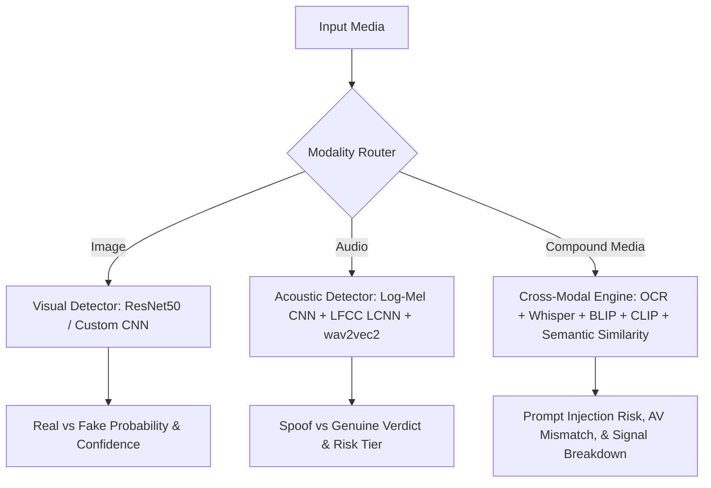

# Concepts: System Overview

> In this page: What deepfakes and manipulation attacks are, what Guardian AI detects, intended beneficiaries, core operating principles, and a terminology glossary.  
> Who it's for: First-time visitors, security analysts, ML researchers, and platform engineers.

---

## What is Guardian AI?

Guardian AI is an open-source, multi-pipeline forensics and manipulation detection platform designed to identify synthetic media, voice spoofing, and multimodal adversarial attacks. Rather than treating synthetic media as a single monolithic problem, Guardian AI partitions detection across three specialized forensic subsystems:

1. **Visual Forensic Pipeline**: Identifies facial manipulation, synthetic face generation (e.g., StyleGAN, Diffusion), and visual artifacts in static portrait imagery.
2. **Acoustic Spoof Pipeline**: Detects synthetic speech, text-to-speech (TTS), voice cloning, and voice conversion (VC) artifacts in raw audio recordings.
3. **Multimodal Injection & Cross-Modal Consistency Engine**: Detects adversarial prompt injection attempts (embedded text or stenographic instructions), visual-textual discrepancies, and audio-visual narrative contradictions in compound media.

---

## Why Multimodal Detection Matters

Deepfake generation tools have evolved beyond isolated single-modality generators. Modern attack vectors include:
- **High-fidelity voice clones** paired with legitimate stock imagery.
- **Synthetically swapped faces** paired with authentic spoken statements.
- **Embedded adversarial prompt injections** hiding instructions inside images or speech to hijack downstream LLM ingest systems.
- **Desynchronized or conflicting audio-visual claims**, where an authentic voice track is overlaid on an unrelated or altered scene.

Unimodal detectors fail when faced with cross-modal attacks because an image classifier cannot hear an artificial voice, and an audio classifier cannot inspect visual tampering. Guardian AI evaluates each modality both independently and in cross-modal alignment to produce verifiable, auditable risk scores.

---

## What Guardian AI Detects

| Threat Vector | Modality | Primary Detection Mechanism | Key Indicators Analyzed |
| :--- | :--- | :--- | :--- |
| **Synthetic Face Generation** | Image | Deep CNN feature representations (ResNet50 / Custom CNN) | Frequency artifacts, unnatural blending boundaries, unnatural pupil/hair textures |
| **Voice Cloning & TTS Spoofing** | Audio | Dual-stream acoustic ensemble (CNN + LCNN) + Transformer Calibrator | Phase discontinuities, spectral envelope irregularities, high-frequency cutoff in LFCC/Mel |
| **Embedded Prompt Injections** | Image | Pixel-level local contrast standard deviation analysis & EasyOCR | Low-contrast "ghost" text, micro-typography, hidden instructions |
| **Adversarial Audio Injections** | Audio | Whisper transcription + Fuzzy keyword matching | System override tokens, jailbreak phrases ("ignore previous", "you are now") |
| **Cross-Modal Mismatch** | Image + Audio | BLIP captioning + Whisper ASR + TF-IDF/Jaccard + CLIP alignment | Semantic contradiction between spoken audio and visual content |

---

## Who Guardian AI is For

- **Integrators & Developers**: Developers deploying content moderation or identity-verification microservices who need ready-to-run REST endpoints (`/predict`, `/predict-audio`, `/predict-multimodal`).
- **Media Platforms & Fact Checkers**: Investigators evaluating user-submitted imagery and audio clips for signs of synthetic generation or audio-visual manipulation.
- **AI Safety & LLM Security Engineers**: Teams protecting multimodal retrieval-augmented generation (RAG) pipelines from prompt injections hidden in images and audio.
- **ML Forensics Researchers**: Academics and students analyzing CNN representations, explainability heatmaps (Grad-CAM, SHAP, Integrated Gradients), and anti-spoofing feature engineering.

---

## Terminology Glossary

- **Deepfake**: Synthetic media generated or manipulated using deep neural networks (such as GANs, VAEs, or diffusion models) to realistically depict individuals speaking or acting falsely.
- **Spoof**: In speech forensics, an artificial audio recording generated using text-to-speech synthesis (TTS) or voice conversion (VC) designed to impersonate human voice biometrics.
- **Bonafide / Genuine**: Authentic, unmanipulated audio recorded directly from a human vocal tract.
- **Log-Mel Spectrogram**: A time-frequency acoustic representation where frequencies are mapped to the non-linear human auditory perceptual scale (Mel scale) and power is expressed in decibels.
- **LFCC (Linear Frequency Cepstral Coefficients)**: A spectral feature representation using linearly spaced filter banks, particularly sensitive to spectral artifacts in higher frequencies produced by synthetic vocoders.
- **LCNN (Light Convolutional Neural Network)**: A parameter-efficient convolutional architecture utilizing Max-Feature-Map (MFM) activation functions, widely benchmarked in biometric anti-spoofing challenges (e.g., ASVspoof).
- **MFM (Max-Feature-Map)**: A non-linear activation layer that splits feature channels in half and takes the element-wise maximum, acting as a competitive feature selector.
- **Prompt Injection**: An adversarial security attack where malicious instructions are smuggled into model inputs to override system prompts or hijack downstream autonomous agents.
- **OCR (Optical Character Recognition)**: Extraction of printed or handwritten text characters directly from pixel rasters.
- **CLIP Alignment**: A metric measuring the cosine similarity of text embeddings and image embeddings in a shared multimodal latent space.
- **Threshold Calibration**: The empirical adjustment of decision thresholds on a held-out validation distribution to optimize precision, recall, or balanced F1-score rather than assuming a default threshold of $0.5$.
- **XAI (Explainable Artificial Intelligence)**: Post-hoc attribution techniques (e.g., Grad-CAM, Saliency Maps, SHAP, Integrated Gradients) that illuminate which spatial or temporal inputs drove model classification.
