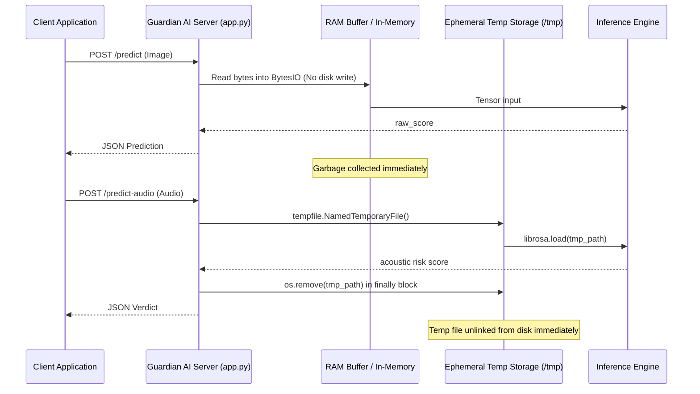

# Concepts: Responsible Use & Limitations

> In this page: Ethical boundaries, intended operational scope, misuse mitigation, privacy guarantees, false positive/negative consequences, and evidentiary status.  
> Who it's for: Compliance officers, platform integrity teams, legal counsel, and deploying engineers.

---

## Intended Purpose

Guardian AI is designed as a forensic triage and investigative aid for detecting AI-generated media, voice synthesis, and multimodal prompt injection attacks. It is intended for:
- Content moderation assistance to triage high-volume user uploads.
- Investigative analysis by journalists, fact-checkers, and digital forensics teams.
- Security boundary defense for multimodal LLMs against visual/acoustic prompt injection.
- Academic and educational research into deepfake forensics and interpretability.

---

## Prohibited & High-Risk Uses

> [!CAUTION]
> Guardian AI is **not** a judicial, criminal evidentiary, or automated sanctioning system. Using raw detection scores to take irreversible actions without human review is strictly discouraged.

The following use cases are out of scope and represent significant risk:
1. **Automated Defamation or Accusation**: Publicly declaring an individual fraudulent or accusing a person of deception based solely on an automated score without independent secondary corroboration.
2. **Sole Evidence in Legal Proceedings**: Presenting Guardian AI outputs as conclusive biometric or forensic legal proof in court. Detection models are statistical classifiers subject to domain shift, compression artifacts, and false positives.
3. **Automated Account Termination**: Banning user accounts or rejecting identity verification documents without a human review queue.
4. **Adversarial Reverse-Engineering**: Using this system to iteratively optimize deepfake generation pipelines to bypass anti-spoofing filters.

---

## False Positives & False Negatives: Operational Impact

Understanding the trade-offs of statistical classification is vital when configuring thresholds:

| Error Type | What Happened | Real-World Impact | Mitigations in Code |
| :--- | :--- | :--- | :--- |
| **False Positive** (Type I) | Authentic media flagged as synthetic / manipulated | Legitimate human creator penalized, valid identity document rejected, false claim of fraud | Multi-signal breakdown in multimodal analysis; secondary calibrator disagreement smoothing in audio |
| **False Negative** (Type II) | Synthetic or manipulated media flagged as genuine | Deceptive media disseminates, social engineering impersonation succeeds, prompt injection reaches LLM | Multi-pipeline defense (audio + visual + OCR + CLIP); adjustable sensitivity via `model_runtime_config.json` |

### Threshold Guidance
- **Moderation Triage (High Sensitivity)**: Configure visual threshold lower (e.g. current setting $\tau = 0.01$) to minimize false negatives and route all questionable media to human reviewers.
- **Automated Filtering (High Specificity)**: Configure visual threshold higher (e.g. $\tau = 0.50$ or tuned via `scripts/calibrate_threshold.py`) if minimizing false accusations is paramount.

---

## Privacy & Media Handling Architecture

A core design requirement of Guardian AI is that user-submitted media must **not** persist beyond the duration of the request:

### Privacy Guarantees Verified in Code:
1. **Visual Media (`/predict`)**: Processed entirely in-memory using `io.BytesIO`. Images are never written to disk or database.
2. **Audio & Multimodal Media (`/predict-audio`, `/predict-multimodal`)**: Uses `tempfile.NamedTemporaryFile` with random UUIDs to interface with libraries requiring file paths (`librosa`, `easyocr`). Every temporary file path is enclosed in a strict `try...finally` block that invokes `os.remove()` unconditionally upon request completion or error.
3. **No External Data Exfiltration**: Inference is executed locally or on your self-hosted server. Media tensors are never transmitted to third-party APIs. Pretrained checkpoints (Whisper, BLIP, CLIP) are cached locally in the filesystem (`$TRANSFORMERS_CACHE`).

---

## Evidentiary and Forensic Disclaimer

Guardian AI provides probabilistic assessment scores based on patterns learned from training distributions (such as the 140k Real & Fake Faces dataset and ASVspoof/Deep Voice benchmarks). It does not guarantee 100% accuracy on real-world media that has undergone heavy platform re-encoding (e.g., WhatsApp, TikTok, YouTube re-compression), post-processing filters, motion blur, or novel generative model architectures.

Always treat Guardian AI scores as an **investigative indicator**, not an absolute verdict.
