# Data: Preprocessing & Feature Engineering

> In this page: Complete specifications of preprocessing pipelines, mathematical normalization transforms, sampling rates, feature extraction parameters, and data augmentations.  
> Who it's for: ML engineers, data scientists, and pipeline developers.

---

## Preprocessing Pipelines at a Glance

```mermaid
graph TD
    subgraph Image_Preprocessing ["Visual Input Preprocessing"]
        RawImg[Raw Image Bytes] --> RGBConv[Convert to 3-Channel RGB]
        RGBConv --> Resize224[Bilinear Resize to 224x224]
        Resize224 --> FloatCast[Cast to Float32 Tensor]
        FloatCast --> ModeCheck{Preprocess Mode?}
        ModeCheck -->|rescale_255| ScaleDiv["arr / 255.0 -> [0.0, 1.0]"]
        ModeCheck -->|resnet50| ResNetNorm["Subtract ImageNet Mean [103.939, 116.779, 123.68]"]
        ModeCheck -->|mobilenet_v2| MobileNorm["Scale to [-1.0, 1.0]"]
    end

    subgraph Audio_Preprocessing ["Acoustic Input Preprocessing"]
        RawWav[Audio File / Bytes] --> Resample[Librosa Load: 16 kHz Mono Float32]
        Resample --> MelPath["Log-Mel Feature Pipeline"]
        Resample --> LFCCPath["LFCC Feature Pipeline"]
        MelPath --> STFT["STFT: n_fft=400, hop=160"]
        STFT --> MelFB["Mel Filterbanks: 80 bands"]
        MelFB --> MelDB["Power to dB: 10*log10(P)"]
        MelDB --> MelZScore["Z-Score: (x - μ) / (σ + 1e-8)"]
        LFCCPath --> LFCCBank["torchaudio.transforms.LFCC (60 coeffs, n_fft=512, hop=160)"]
        LFCCBank --> LFCCZScore["Z-Score: (x - μ) / (σ + 1e-8)"]
    end
```



---

## 1. Visual Preprocessing

### Pipeline Steps in Production (`app.py`)
1. **Pillow Ingestion**:
   ```python
   image = Image.open(BytesIO(image_bytes)).convert("RGB")
   ```
   Ensures single-channel grayscale or 4-channel RGBA formats are standardized to 3-channel RGB.
2. **Resizing**:
   ```python
   image = image.resize(INPUT_SIZE) # default: (224, 224)
   ```
3. **Array Casting & Batch Expansion**:
   ```python
   img_array = np.array(image, dtype=np.float32)
   img_array = np.expand_dims(img_array, axis=0) # Shape: (1, 224, 224, 3)
   ```

### Normalization Modes
Defined in `app.py` via `PREPROCESS_MODE`:
- **`rescale_255` (Default production mode)**:
  $$x_{norm} = \frac{x}{255.0} \in [0.0, 1.0]$$
- **`resnet50`**:
  Applies `tf.keras.applications.resnet50.preprocess_input`. Converts RGB to BGR and zero-centers each color channel with respect to the ImageNet dataset ($[103.939, 116.779, 123.68]$).
- **`mobilenet_v2`**:
  Applies `tf.keras.applications.mobilenet_v2.preprocess_input`, scaling input pixel floats into $[-1.0, 1.0]$.
- **`auto`**:
  Inspects loaded Keras model layer names to dynamically select the matching preprocessing mode.

### Training-Time Data Augmentation
Used in `Proposed_Custom_Hybrid-CNN(Optmized).py` and `Model/DeepFake-CNN-Custom.ipynb`:
```python
image_gen = ImageDataGenerator(
    rescale=1./255.,
    rotation_range=20,
    shear_range=0.2,
    zoom_range=0.2,
    horizontal_flip=True
)
```

---

## 2. Acoustic Preprocessing

Implemented in `modules/audio_spoof_system/inference.py`:

### Audio Normalization & Ingestion
```python
audio, sr = librosa.load(audio_path, sr=16000, mono=True)
audio = audio.astype(np.float32)
```
- Standardized to $16,000\text{ Hz}$ single-channel (mono) floating point arrays.

### Log-Mel Spectrogram Extraction
```python
def extract_logmel(audio, sr=16000):
    mel = librosa.feature.melspectrogram(
        y=audio, sr=sr, n_mels=80,
        n_fft=400, hop_length=160
    )
    logmel = librosa.power_to_db(mel)
    logmel = (logmel - logmel.mean()) / (logmel.std() + 1e-8)
    return logmel
```

### LFCC Extraction
```python
def extract_lfcc(audio, sr=16000):
    waveform = torch.FloatTensor(audio).unsqueeze(0)
    lfcc_transform = torchaudio.transforms.LFCC(
        sample_rate=sr,
        n_lfcc=60,
        speckwargs={"n_fft": 512, "hop_length": 160}
    )
    lfcc = lfcc_transform(waveform).squeeze(0).numpy()
    lfcc = (lfcc - lfcc.mean()) / (lfcc.std() + 1e-8)
    return lfcc
```

---

## 3. Multimodal Feature Preprocessing

Implemented in `modules/multimodal_injection/multimodal_detector.py`:
- **Grayscale Local Variance**: Image converted to 8-bit grayscale (`Image.convert('L')`) and split into non-overlapping $32 \times 32$ pixel tiles to evaluate local standard deviation $\sigma$.
- **EasyOCR Ingestion**: Raw image file path passed directly to EasyOCR reader with confidence threshold filtering ($\ge 0.40$).
- **BLIP Scene Ingestion**: Preprocessed via `BlipProcessor.from_pretrained("Salesforce/blip-image-captioning-base")` with PyTorch tensor output.
- **CLIP Alignment**: Preprocessed via `CLIPProcessor.from_pretrained("openai/clip-vit-base-patch32")` with text padding and image tensor conversion.
- **Whisper ASR**: Ingests $16\text{ kHz}$ mono float32 arrays into the Hugging Face `automatic-speech-recognition` pipeline.
