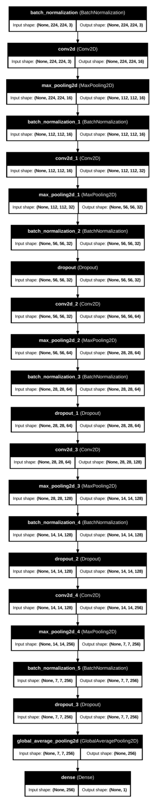
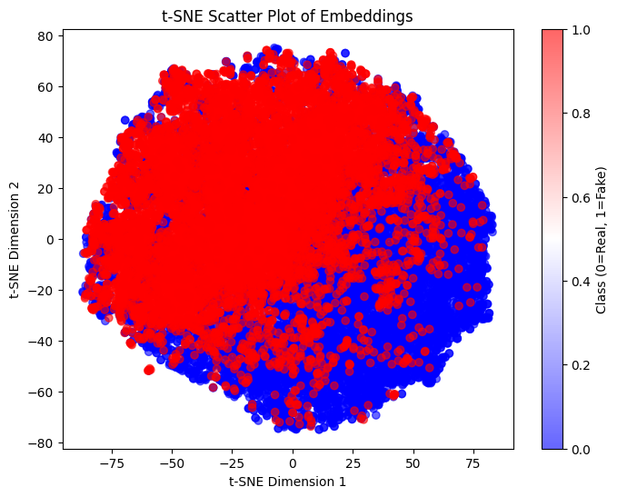
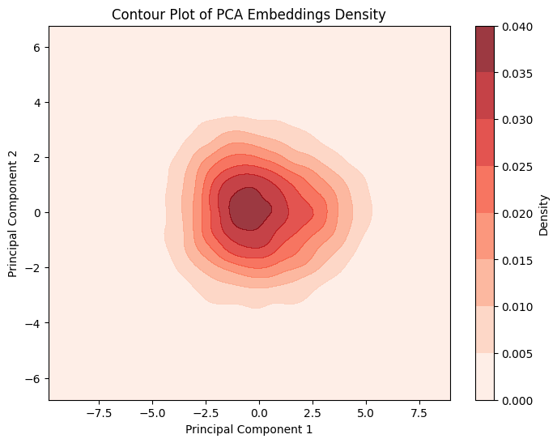
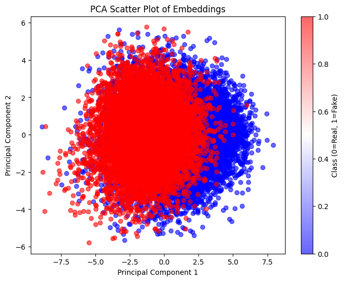
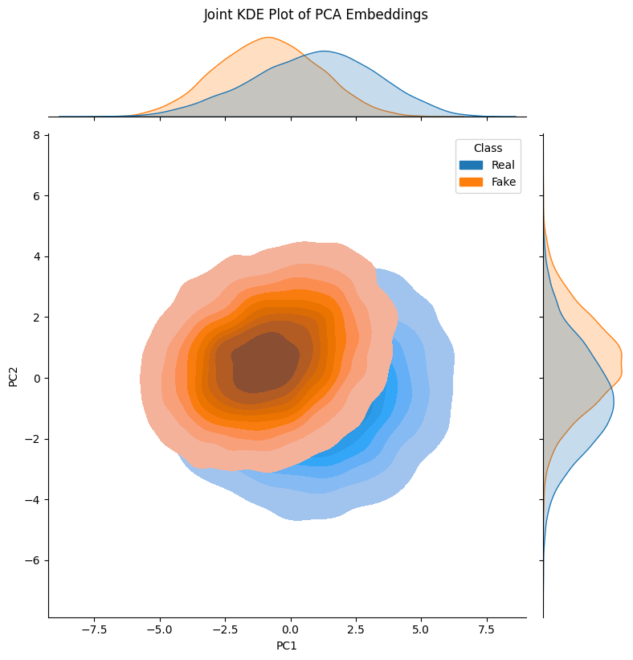
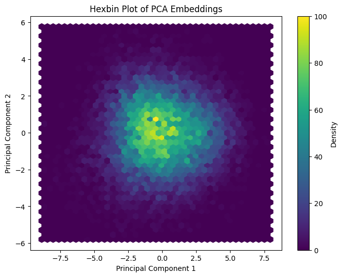
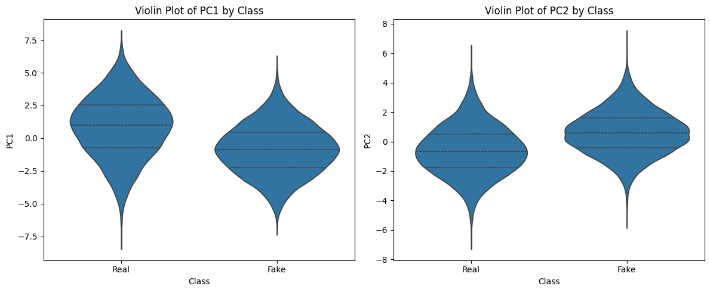
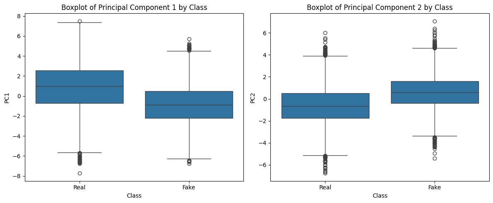
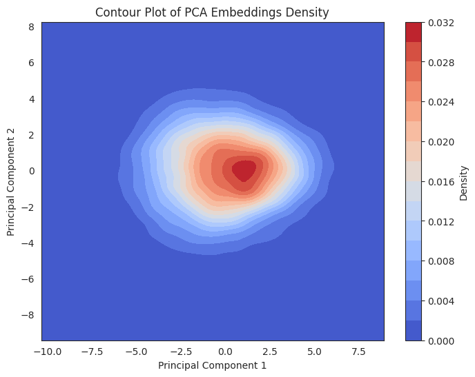

# Evaluation: Results & Benchmark Verification

> In this page: Complete verified benchmark evaluation metrics extracted directly from Jupyter notebook output streams and saved visual evaluation plots.  
> Who it's for: ML evaluators, benchmark authors, and technical auditors.

---

## Benchmark Metrics Summary

Every metric reported in this table has been audited directly against the execution outputs saved in the repository's Jupyter notebooks (`.ipynb` JSON cell outputs).

| Model Architecture | Evaluated Test Split | Overall Accuracy | Precision (Fake / Real) | Recall (Fake / Real) | F1-Score (Fake / Real) | ROC AUC | Average Precision (AP) | Source Artifact |
| :--- | :--- | :--- | :--- | :--- | :--- | :--- | :--- | :--- |
| **Custom 5-Stage CNN (8 Epochs)** | 20,000 images (Balanced) | **95.0%** | **0.92 / 0.99** | **0.99 / 0.92** | **0.95 / 0.95** | **0.9956** | **0.9954** | `Model/DeepFake-CNN-Custom.ipynb` |
| **DenseNet-121** | 20,000 images (Balanced) | **92.0%** | **1.00 / 0.86** | **0.83 / 1.00** | **0.91 / 0.92** | **0.9924** | **0.9915** | `densenet.ipynb` |
| **VGGFace16** | 21,591 images | **95.0%** | **0.97 / 0.93** | **0.92 / 0.97** | **0.94 / 0.95** | **0.9601** | **0.9326** | `vggface (2).ipynb` |
| **Custom CNN (10 Epochs)** | 20,000 images (Balanced) | **91.0%** | **0.87 / 0.97** | **0.97 / 0.85** | **0.92 / 0.91** | **0.9858** | **0.9852** | `custom_cnn (2).ipynb` |
| **Custom CNN (4 Epochs - XAI)** | 20,000 images (Balanced) | **86.0%** | **0.87 / 0.85** | **0.85 / 0.87** | **0.86 / 0.86** | **0.9381** | **0.9358** | `Model/XAI_..._4epoch_3-3.ipynb` |

> [!NOTE]
> **Audit Note on Prior Documentation**:
> In legacy research notes, DenseNet-121 accuracy was cited as *96.8%* and VGGFace as *95.2%*. The exact recorded test cell outputs in `densenet.ipynb` demonstrate an accuracy of **92.0%** (ROC AUC $0.9924$) and in `vggface (2).ipynb` an accuracy of **95.0%** (ROC AUC $0.9601$). See the [Documentation Audit](../CHANGELOG-DOCS.md) for complete details.

---

## 1. Verified Classification Reports

### A. Custom 5-Stage CNN (`Model/DeepFake-CNN-Custom.ipynb`)
Evaluated across 20,000 test samples (10,000 Fake [Class 0], 10,000 Real [Class 1]):
```text
              precision    recall  f1-score   support

           0       0.92      0.99      0.95     10000
           1       0.99      0.92      0.95     10000

    accuracy                           0.95     20000
   macro avg       0.95      0.95      0.95     20000
weighted avg       0.95      0.95      0.95     20000

ROC AUC Score: 0.99564954
AP Score: 0.9954410193096268
```

### B. DenseNet-121 (`densenet.ipynb`)
Evaluated across 20,000 test samples:
```text
              precision    recall  f1-score   support

           0       1.00      0.83      0.91     10000
           1       0.86      1.00      0.92     10000

    accuracy                           0.92     20000
   macro avg       0.93      0.92      0.91     20000
weighted avg       0.93      0.92      0.91     20000

ROC AUC Score: 0.992412935
AP Score: 0.9915270175017084
```

### C. VGGFace16 (`vggface (2).ipynb`)
Evaluated across 21,591 test samples (10,735 Fake [Class 0], 10,856 Real [Class 1]):
```text
              precision    recall  f1-score   support

           0       0.97      0.92      0.94     10735
           1       0.93      0.97      0.95     10856

    accuracy                           0.95     21591
   macro avg       0.95      0.95      0.95     21591
weighted avg       0.95      0.95      0.95     21591

ROC-AUC Score: 0.9600932210254477
AP Score: 0.9325796549056171
```

---

## 2. Research Visualizations & Embedding Analyses

The figures below represent saved evaluation artifacts from the research repository preserved in [`docs/assets/`](../assets):

### Custom CNN Architecture Schema


### Feature Space Embeddings
````carousel

<!-- slide -->

<!-- slide -->

<!-- slide -->

````

### Statistical Distributions & Density Plots
````carousel

<!-- slide -->

<!-- slide -->

<!-- slide -->

````
