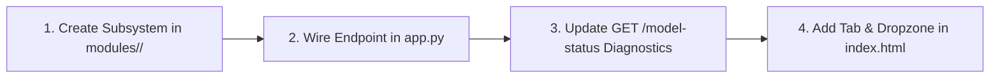

# Guides: Adding a New Modality or Forensic Model

> In this page: Architectural instructions for extending Guardian AI with new forensic modalities (e.g., video temporal forensics, text authenticity) or integrating alternative models.  
> Who it's for: Open-source contributors, researchers, and systems architects.

---

## Extension Pattern Overview

Guardian AI's architecture is deliberately modular. Integrating a new forensic modality involves four discrete steps:



---

## Step 1: Implement the Forensic Subsystem

Create a new directory under `modules/` (for example, `modules/video_temporal_system/`):
```text
modules/
└── video_temporal_system/
    ├── __init__.py
    ├── detector.py
    └── requirements.txt
```

In `detector.py`, define an isolated `predict(video_path: str) -> dict` function that encapsulates feature extraction and model inference, returning a dictionary with standard keys:
- `raw_score` (`float`)
- `verdict` (`str`)
- `risk_tier` (`str`: `"LOW"`, `"MEDIUM"`, `"HIGH"`, `"CRITICAL"`)
- `explanation` (`str`)

---

## Step 2: Wire the Route into `app.py`

In `app.py`:
1. Add an isolated import and loader function:
   ```python
   VIDEO_ROOT = WORKSPACE_DIR / "modules" / "video_temporal_system"
   video_predict = None
   VIDEO_LOAD_ERROR = None

   def ensure_video_loaded():
       global video_predict, VIDEO_LOAD_ERROR
       if video_predict is not None or VIDEO_LOAD_ERROR is not None:
           return
       try:
           sys.path.insert(0, str(VIDEO_ROOT.resolve()))
           from detector import predict as _vpredict
           video_predict = _vpredict
       except Exception as exc:
           VIDEO_LOAD_ERROR = str(exc)
   ```

2. Register the HTTP endpoint:
   ```python
   @app.route("/predict-video", methods=["GET", "POST"])
   def predict_video():
       if request.method == "GET":
           return jsonify({"message": "Use POST /predict-video with form-data key 'video'."})
       ensure_video_loaded()
       if video_predict is None:
           return jsonify({"error": f"Video model failed to load: {VIDEO_LOAD_ERROR}"}), 500
       
       # Handle tempfile, call video_predict, and cleanup
   ```

---

## Step 3: Register in Diagnostics (`/model-status`)

In `app.py`, update `def model_status()` to expose your subsystem's health:
```python
"video_root": str(VIDEO_ROOT),
"video_model_loaded": video_predict is not None,
"video_model_error": VIDEO_LOAD_ERROR,
```

---

## Step 4: Add UI Tab in `index.html`

In `index.html`:
1. Add your modality definition to the `TABS` constant:
   ```javascript
   const TABS = [
       { id: "audio",      label: "Audio",      accept: ".mp3,.wav,.ogg,.m4a,.flac" },
       { id: "video",      label: "Image",      accept: ".jpg,.jpeg,.png,.webp,.bmp" },
       { id: "multimodal", label: "Multimodal", accept: ".jpg,.png,.wav,.mp3" },
       { id: "temporal",   label: "Video",      accept: ".mp4,.avi,.mov,.webm" },
   ];
   ```
2. Define corresponding left-panel text and features in `PANEL_INFO`.
3. In `AnalyserPanel.analyse()`, route `tabId === "temporal"` to `/predict-video`.
