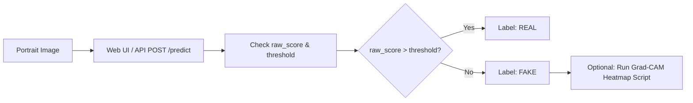

# Guides: Detecting Deepfakes in Images

> In this page: Practical walkthrough for evaluating images for facial manipulation, using the web interface, curl, and Python, with guidance on interpreting scores.  
> Who it's for: Investigators, moderators, and software developers.

---

## Detection Workflow



---

## 1. Web Interface Walkthrough

1. Open `http://127.0.0.1:8080/` in your browser.
2. Click the **Image** tab in the central analyser console.
3. Drag and drop a facial portrait image (`.jpg`, `.png`, `.webp`, `.bmp`) into the dropzone.
4. Click **Analyse Image**.
5. Within $< 200\text{ ms}$, the panel renders:
   - **Prediction**: `REAL` (green) or `FAKE` (red).
   - **Confidence**: Percentage certainty.
   - **Raw Score & Threshold**: Exact float values for decision verification.
   - **Processing Time**: Elapsed server-side inference time.

---

## 2. CLI Execution via cURL

```bash
curl -X POST http://127.0.0.1:8080/predict \
  -F "image=@/path/to/test_image.jpg"
```

### Example JSON Response
```json
{
  "label": "REAL",
  "confidence": 98.45,
  "raw_score": 0.9845,
  "processing_time_sec": 0.075,
  "threshold": 0.01,
  "positive_label": "REAL",
  "negative_label": "FAKE",
  "message": "This image is REAL with 98.45% confidence"
}
```

---

## 3. Programmatic Python Client

```python
import requests

def analyze_image(image_path: str, api_url: str = "http://127.0.0.1:8080/predict"):
    with open(image_path, "rb") as f:
        response = requests.post(api_url, files={"image": f})
    
    if response.status_code != 200:
        raise RuntimeError(f"Inference failed ({response.status_code}): {response.text}")
    
    data = response.json()
    print(f"File:       {image_path}")
    print(f"Verdict:    {data['label']} ({data['confidence']}%)")
    print(f"Raw Score:  {data['raw_score']} (Threshold: {data['threshold']})")
    print(f"Latency:    {data['processing_time_sec']}s")
    return data

if __name__ == "__main__":
    analyze_image("modules/multimodal_injection/test_image.jpg")
```

---

## 4. Interpreting the Forensic Output

- **`raw_score`**: The sigmoid activation of the output layer, $\hat{y} \in [0.0, 1.0]$.
- **`threshold`**: The operational decision boundary from `model_runtime_config.json` (calibrated to $0.01$).
  - If $\hat{y} > 0.01 \implies \mathbf{REAL}$ with confidence $\hat{y} \times 100\%$.
  - If $\hat{y} \le 0.01 \implies \mathbf{FAKE}$ with confidence $(1.0 - \hat{y}) \times 100\%$.
- **Boundary Cases ($0.005 < \hat{y} < 0.05$)**: Scores near the calibrated boundary indicate ambiguous feature activations (e.g. slight compression or unusual lighting). Route boundary images to human review or generate an XAI Grad-CAM attribution map.
