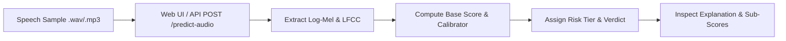

# Guides: Detecting Synthetic Speech & Audio Spoofs

> In this page: Step-by-step walkthrough for detecting AI-generated voices, TTS clones, and voice conversions, using the Web UI, REST API, Python, and local CLI tools.  
> Who it's for: Audio forensics specialists, trust & safety reviewers, and developers.

---

## Detection Workflow



---

## 1. Web Interface Walkthrough

1. Navigate to `http://127.0.0.1:8080/`.
2. Select the **Audio** tab.
3. Drop a `.wav`, `.mp3`, `.ogg`, `.flac`, or `.m4a` speech recording into the dropzone.
4. Click **Analyse Audio**.
5. The console displays:
   - **Verdict**: `GENUINE` (green) or `SPOOF` (red).
   - **Risk Score**: Aggregated synthetic risk percentage.
   - **Risk Tier**: `LOW`, `MEDIUM`, `HIGH`, or `CRITICAL`.
   - **Explanation**: Human-readable breakdown showing individual CNN, LCNN, and Calibrator contributions.

---

## 2. CLI Execution via cURL

```bash
curl -X POST http://127.0.0.1:8080/predict-audio \
  -F "audio=@modules/audio_spoof_system/wav samples/spoof1.wav"
```

### Example JSON Output
```json
{
  "cnn_score": 0.8845,
  "lcnn_score": 0.9120,
  "calibrator_score": 0.8950,
  "primary_score": 0.8969,
  "calibration_mode": "standard",
  "risk_score": 0.8964,
  "verdict": "SPOOF",
  "risk_tier": "CRITICAL",
  "models_used": "CNN + LCNN (primary) | Calibrator (standard)",
  "explanation": "Primary models — CNN: 88.5%, LCNN: 91.2%. Calibrator: 89.5%. Final risk: 89.6% (CRITICAL)",
  "audio_file": "spoof1.wav",
  "processing_time_sec": 0.042
}
```

---

## 3. Direct Local CLI Execution (No Server Needed)

You can run inference directly in your terminal using the standalone script:

```bash
python modules/audio_spoof_system/inference.py "modules/audio_spoof_system/wav samples/bonafide2.wav"
```

Output:
```text
All models loaded — CNN + LCNN (primary) + Calibrator (secondary)
cnn_score: 0.0312
lcnn_score: 0.0450
calibrator_score: 0.0280
primary_score: 0.0374
calibration_mode: standard
risk_score: 0.0351
verdict: GENUINE
risk_tier: LOW
models_used: CNN + LCNN (primary) | Calibrator (standard)
explanation: Primary models — CNN: 3.1%, LCNN: 4.5%. Calibrator: 2.8%. Final risk: 3.5% (LOW)
```

---

## 4. Interpreting the Forensic Signals

- **`cnn_score`**: Spoof probability from the Squeeze-and-Excitation network operating on Log-Mel spectrograms.
- **`lcnn_score`**: Spoof probability from the Max-Feature-Map network operating on Linear Frequency Cepstral Coefficients (sensitive to high-frequency vocoder ringing).
- **`calibrator_score`**: Secondary verification from `wav2vec2-large-xlsr`.
- **`calibration_mode`**:
  - `standard`: Primary ensemble and calibrator are in mutual agreement ($\Delta < 0.35$).
  - `calibrated_moderate` / `calibrated_strong`: Calibrator stepped in to smooth an overconfident prediction.
  - `primary_only`: Running without transformer calibrator.
- **Risk Tiers**:
  - $\mathbf{LOW}$ ($< 0.30$): Highly likely human speech.
  - $\mathbf{MEDIUM}$ ($0.30–0.60$): Borderline quality or slight acoustic distortion; human review advised.
  - $\mathbf{HIGH}$ ($0.60–0.85$): Definite synthetic speech artifacts identified.
  - $\mathbf{CRITICAL}$ ($\ge 0.85$): Extremely high confidence neural TTS or voice clone.
