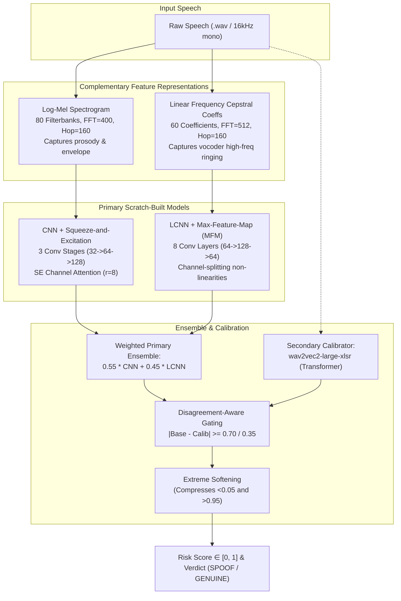

# Models: Acoustic Spoof & Voice Detector

> In this page: Deep-dive into acoustic feature engineering (Log-Mel and LFCC), CNN and LCNN model architectures, Max-Feature-Map activations, calibration fusion, and experimental speech models.  
> Who it's for: Audio engineers, speech researchers, and biometrics specialists.

---

## Acoustic Architecture Overview

Guardian AI's acoustic anti-spoofing engine (`modules/audio_spoof_system/`) operates on the principle that synthetic speech leaves distinct micro-temporal and spectral artifacts depending on whether features are analyzed in perceptual or linear frequency spaces.



---

## 1. Feature Representation Engineering

### Log-Mel Spectrogram
- **Extraction Function**: `extract_logmel(audio, sr=16000)` via `librosa.feature.melspectrogram`.
- **Number of Mel Bins**: $n\_mels = 80$.
- **FFT Size**: $n\_fft = 400$ ($25\text{ ms}$ analysis window).
- **Hop Length**: $hop\_length = 160$ ($10\text{ ms}$ frame step).
- **Decibel Scaling**: Power converted to decibels (`librosa.power_to_db`).
- **Standardization**: Zero-mean, unit-variance z-score normalization:
  $$\mathbf{X}_{Mel} = \frac{\mathbf{X} - \mu}{\sigma + 10^{-8}}$$

### Linear Frequency Cepstral Coefficients (LFCC)
- **Extraction Function**: `extract_lfcc(audio, sr=16000)` via `torchaudio.transforms.LFCC`.
- **Number of Coefficients**: $n\_lfcc = 60$.
- **FFT Size**: $n\_fft = 512$ ($32\text{ ms}$ window).
- **Hop Length**: $160$ ($10\text{ ms}$ step).
- **Linear Filterbank Advantage**: While Mel scales compress higher frequencies, LFCC retains fine spectral resolution up to the $8\text{ kHz}$ Nyquist limit, preserving Phase discontinuities and spectral peaks introduced by synthetic neural vocoders (e.g. HiFi-GAN, WaveGlow).

---

## 2. Neural Network Architectures

### CNN with Squeeze-and-Excitation (`CNNModel`)
The CNN model processes the 80-bin Mel spectrogram using 2D convolutions followed by channel-wise self-attention:

```python
class SqueezeExcitation(nn.Module):
    def __init__(self, channels, reduction=8):
        super().__init__()
        self.se = nn.Sequential(
            nn.AdaptiveAvgPool2d(1),
            nn.Flatten(),
            nn.Linear(channels, channels // reduction),
            nn.ReLU(),
            nn.Linear(channels // reduction, channels),
            nn.Sigmoid()
        )

    def forward(self, x):
        scale = self.se(x).view(x.size(0), x.size(1), 1, 1)
        return x * scale
```

### LCNN with Max-Feature-Map (`LCNNModel`)
The Light CNN architecture utilizes Max-Feature-Map (MFM) activation functions. Unlike standard ReLU activations which discard negative values, MFM acts as a competitive filter selection mechanism:

```python
class MFM(nn.Module):
    """Max Feature Map — splits channels in half and takes element-wise max."""
    def forward(self, x):
        x1, x2 = x.chunk(2, dim=1)
        return torch.max(x1, x2)
```

By halving the channel count at each layer through competitive selection, MFM suppresses noise and non-informative acoustic frequency variations, making it exceptionally robust against noise in anti-spoofing evaluations.

---

## 3. Disagreement-Gated Calibration & Risk Tiers

In `modules/audio_spoof_system/inference.py`, the primary CNN + LCNN ensemble score is guarded by a secondary pretrained transformer (`wav2vec2-large-xlsr`):

$$\Delta = |S_{base} - P_{calib}|$$

- **Strong Disagreement ($\Delta \ge 0.70$)**: The calibrator pulls the score heavily:
  $$S_{corrected} = 0.55 \cdot S_{base} + 0.45 \cdot P_{calib} \quad (\text{mode: "calibrated\_strong"})$$
- **Moderate Disagreement ($0.35 \le \Delta < 0.70$)**:
  $$S_{corrected} = 0.65 \cdot S_{base} + 0.35 \cdot P_{calib} \quad (\text{mode: "calibrated\_moderate"})$$
- **Standard Agreement ($\Delta < 0.35$)**:
  $$S_{corrected} = 0.75 \cdot S_{base} + 0.25 \cdot P_{calib} \quad (\text{mode: "standard"})$$
- **Calibrator Unavailable / Failed**:
  $$S_{corrected} = S_{base} \quad (\text{mode: "primary\_only"})$$

### Extreme Score Compression
To prevent probability collapse to exact $0.0$ or $1.0$:
```python
def soften_extremes(score: float) -> float:
    if score > 0.95:
        return 0.95 + ((score - 0.95) * 0.25)
    if score < 0.05:
        return 0.05 - ((0.05 - score) * 0.25)
    return score
```

---

## 4. Research Explorations: Transformer & LSTM Ensembles

In research scripts (`Deepfake Voice Detection/deep_fake_voice_recognition.py`), additional speech modeling paradigms were explored on the Kaggle Deep Voice dataset:
1. **Multi-Head Self-Attention Transformer**:
   - 4 attention heads, 32-dimensional feed-forward dimension, Layer Normalization, and custom `PositionalEmbedding`.
2. **Hybrid Transformer + LSTM Branching Model**:
   - Dual-branch architecture combining a 2-block Multi-Head Transformer branch with a 64-unit bidirectional LSTM branch, concatenated and regularized via L2 weight penalties and Batch Normalization.
