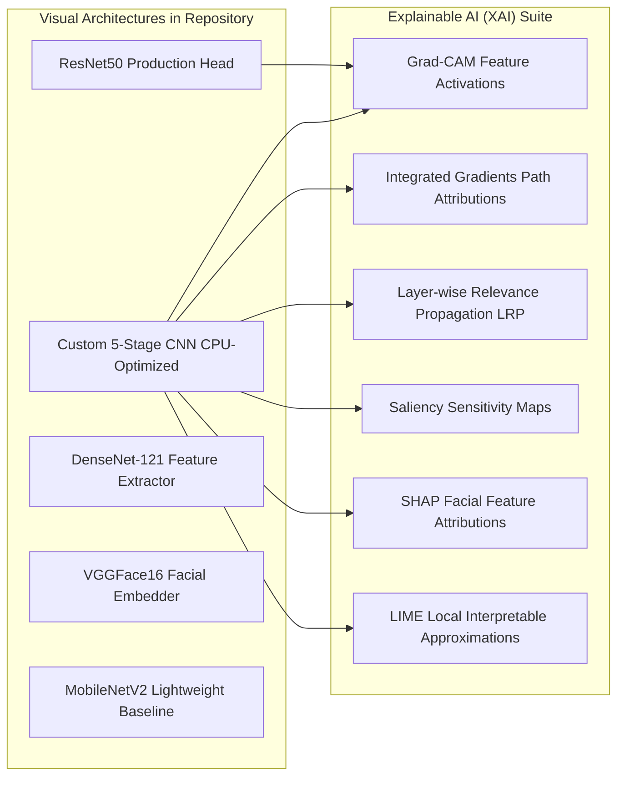

# Models: Visual Deepfake Detector

> In this page: Architecture deep-dive of visual classifiers, preprocessing and data augmentation pipelines, fine-tuning setups, and Explainable AI (XAI) visual attributions.  
> Who it's for: Computer vision researchers, ML engineers, and forensic analysts.

---

## Visual Architecture Overview

Guardian AI's visual detection research encompasses both transfer learning from pretrained vision backbones and specialized from-scratch convolutional neural networks optimized for high-throughput forensic screening.



---

## 1. Production Model: ResNet50 Classifier

The shipped visual model (`models/visual_model.h5`, `models/new_model.h5`) leverages a 181-layer Deep Residual Network (ResNet50) backbone. ResNet's identity shortcut connections preserve high-frequency pixel gradients and subtle edge boundaries across deep feature maps, which are critical for detecting synthetic blending seams around hair, jawlines, and eyes.

### Layer Specifications
- **Input Dimensions**: $(224, 224, 3)$
- **Residual Stages**: 5 residual stages (`conv2_x` through `conv5_x`) producing a $(7, 7, 2048)$ feature map.
- **Global Average Pooling**: Compresses spatial dimensions into a $2048$-dimensional feature embedding.
- **Classification Head**:
  - `Dense(256, activation='relu')`
  - `Dropout(rate=0.5)` for strong regularization against facial memorization.
  - `Dense(128, activation='relu')`
  - `Dropout(rate=0.3)`
  - `Dense(1, activation='sigmoid')` yielding probability $\hat{y} \in [0, 1]$.

---

## 2. Custom 5-Stage CNN (CPU-Optimized)

Defined in `Proposed_Custom_Hybrid-CNN(Optmized).py` and `Model/DeepFake-CNN-Custom.ipynb`, this architecture was designed for low-latency CPU inference without heavy transformer or ResNet parameter counts:

```python
model = Sequential()
model.add(BatchNormalization(input_shape=(224, 224, 3)))
model.add(Conv2D(16, kernel_size=3, activation='relu', padding='same'))
model.add(MaxPooling2D(pool_size=2))
model.add(BatchNormalization())

model.add(Conv2D(32, kernel_size=3, activation='relu', padding='same'))
model.add(MaxPooling2D(pool_size=2))
model.add(BatchNormalization())
model.add(Dropout(0.1))

model.add(Conv2D(64, kernel_size=3, activation='relu', padding='same'))
model.add(MaxPooling2D(pool_size=2))
model.add(BatchNormalization())
model.add(Dropout(0.1))

model.add(Conv2D(128, kernel_size=3, activation='relu', padding='same'))
model.add(MaxPooling2D(pool_size=2))
model.add(BatchNormalization())
model.add(Dropout(0.1))

model.add(Conv2D(256, kernel_size=3, activation='relu', padding='same'))
model.add(MaxPooling2D(pool_size=2))
model.add(BatchNormalization())
model.add(Dropout(0.1))

model.add(GlobalAveragePooling2D())
model.add(Dense(1, activation='sigmoid'))
```

---

## 3. Preprocessing & Augmentation Strategy

Data augmentation in training scripts (`train_flow`) was explicitly designed to prevent the network from memorizing facial identity while enhancing sensitivity to compression and geometric manipulation:
- **Rescaling**: Pixel intensity division by $255.0$ (`rescale=1./255.`).
- **Rotation**: Random rotation up to $20^\circ$.
- **Shear Transformation**: Random shear distortion up to $0.2$.
- **Zoom**: Random zoom variations up to $20\%$.
- **Horizontal Flipping**: Random horizontal reflection (`horizontal_flip=True`).
- **Target Size**: Rigidly resized to $224 \times 224$ pixels across training, validation, and test generators.

---

## 4. Explainable AI (XAI) Suite

To provide transparent forensic justification, multiple XAI techniques were implemented and tested in `Model/XAI_implementation_finalized_4epoch_3-3.ipynb`:

| Method | Implementation Mechanism | Forensic Purpose |
| :--- | :--- | :--- |
| **Grad-CAM** | Gradients of target class score pooled across the final `Conv2D` feature activations | Visualizes macro spatial attention (e.g. eye boundaries, mouth manipulation) |
| **Integrated Gradients (IG)** | Path integral of gradients along a linear interpolation from black/mean baseline to image ($N=100–200$ steps) | Identifies fine-grained pixel attribution without gradient saturation |
| **Layer-wise Relevance Propagation (LRP)** | Backpropagation of positive contributions through layer weights | Verifies whether decisions depend on facial structure vs background noise |
| **Saliency Maps** | Maximum absolute input-space gradient across RGB color channels | Highlights sharpest pixel sensitivities |
| **SHAP** | Kernel/ImageExplainer with Telea inpainting background mask | Computes game-theoretic Shapley values for image superpixels |
| **LIME** | Quickshift superpixel segmentation with linear surrogate model | Explains individual local predictions by perturbing facial superpixels |
