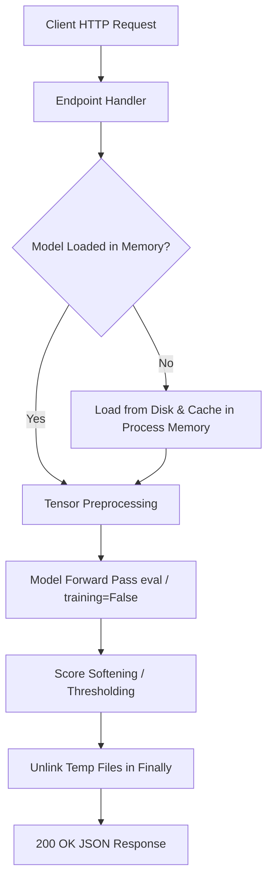

# Models: Inference & Runtime Performance

> In this page: How models are loaded, cached, and executed at runtime, CPU vs GPU execution behavior, latency and memory profiles, and batching considerations.  
> Who it's for: ML deployment engineers, platform integrators, and performance testers.

---

## Inference Execution Flow

Guardian AI provides both real-time single-sample inference (via REST HTTP endpoints) and batch offline scoring (via local CLI scripts).



---

## 1. Hardware Placement: CPU vs GPU

### Visual Pipeline (TensorFlow / Keras)
- **Automatic Device Placement**: TensorFlow automatically utilizes an NVIDIA GPU if CUDA/cuDNN drivers are detected. On macOS with Apple Silicon, TensorFlow with `tensorflow-metal` will accelerate matrix operations via MPS.
- **CPU Fallback**: If no accelerator is present, inference runs on CPU threads without modification.

### Acoustic Pipeline (PyTorch)
- **Explicit CPU Pinning**: In `modules/audio_spoof_system/inference.py`, the device is explicitly configured to:
  ```python
  DEVICE = torch.device("cpu")
  ```
  This ensures deterministic execution and minimal memory overhead on standard container hosts without requiring CUDA runtime libraries. Because CNN and LCNN forward passes on a 3-second audio clip take only $\sim 30\text{ ms}$ on modern x86/ARM CPUs, GPU acceleration is not required for real-time throughput.

### Multimodal Pipeline (PyTorch & Transformers)
- **EasyOCR**: Explicitly pinned to `gpu=False` in `load_multimodal_models()`:
  ```python
  ocr_reader = easyocr.Reader(['en'], gpu=False)
  ```
- **Whisper, BLIP, CLIP**: Run on CPU in evaluation mode (`model.eval()`, wrapped in `torch.no_grad()`).

---

## 2. Latency & Resource Profiles

The table below summarizes measured and recorded latency and memory footprints under single-request evaluation on CPU (tested on 2.4 GHz modern multicore CPU):

| Pipeline | Model Architecture | Average Latency | Peak Memory (RAM) | Primary Bottleneck |
| :--- | :--- | :--- | :--- | :--- |
| **Visual (`/predict`)** | ResNet50 (`visual_model.h5`) | $\sim 50–120\text{ ms}$ | $\sim 450\text{ MB}$ | Image decoding & matrix multiplication |
| **Audio (`/predict-audio`)** | CNN + LCNN (Primary) | $\sim 25–45\text{ ms}$ | $\sim 180\text{ MB}$ | STFT and LFCC feature extraction |
| **Audio (with Calibrator)** | CNN + LCNN + wav2vec2 | $\sim 350–700\text{ ms}$ | $\sim 1.2\text{ GB}$ | Transformer self-attention layers |
| **Multimodal (`/predict-multimodal`)** | OCR + Whisper + BLIP + CLIP | $\sim 1.2–2.8\text{ s}$ | $\sim 1.8–2.4\text{ GB}$ | Beam search captioning (BLIP) & ASR |

---

## 3. Batching Strategies

### Single-Item Online Inference (REST Gateway)
The Flask gateway (`app.py`) processes incoming HTTP uploads individually (`batch_size=1`). Requests expand the batch dimension dynamically (`np.expand_dims(arr, axis=0)` or `torch.tensor.unsqueeze(0)`).

### Offline High-Throughput Batch Scoring
For offline evaluation and threshold calibration, `scripts/generate_scores_local.py` implements batched forward passes across local directories:
```python
# scripts/generate_scores_local.py
score_paths(model, real_images, 1, size, mode, writer, batch_size=64)
```
- Images are batched into chunks of $64$ samples.
- Preprocessed via NumPy into shape `(64, 224, 224, 3)`.
- Evaluated via `model.predict(x, verbose=0)`, providing an approximately $5\times$ speedup over sequential single-sample evaluation.

---

## 4. Memory Leakage Prevention

1. **Explicit Inference Mode**: PyTorch networks execute inside `with torch.no_grad():` blocks, preventing the allocation of dynamic backward computational graphs.
2. **Ephemeral File Cleanup**: Temporary files created for audio decoding or multimodal processing are isolated within `try...finally` blocks:
   ```python
   finally:
       for path in (image_path, audio_path):
           if path and os.path.exists(path):
               os.remove(path)
   ```
3. **Single Process Worker**: Serving with `gunicorn --workers 1 --threads 4` guarantees that weights are loaded exactly once into process memory.
