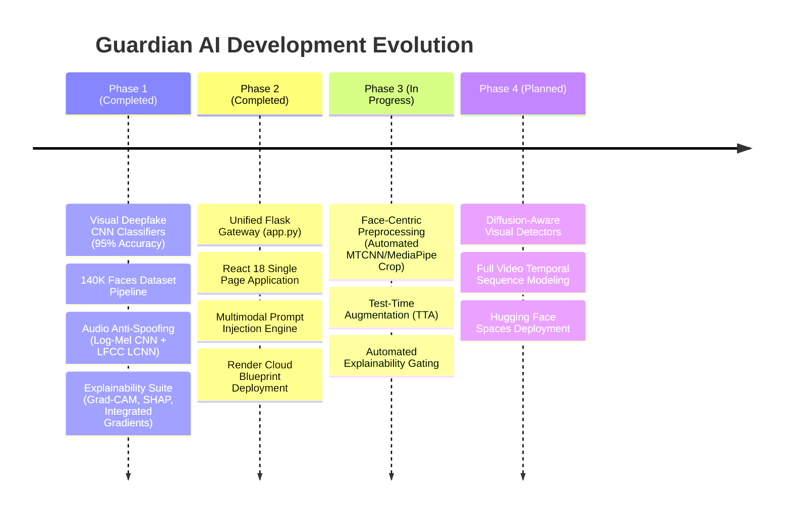

# Project: Roadmap & Future Work

> In this page: Current development status, completed milestones, work in progress, and planned future enhancements.  
> Who it's for: Contributors, stakeholders, and community members tracking project evolution.

---

## Development Milestones

---

## 1. Completed Capabilities

- [x] **Visual Detection Pipeline**: ResNet50 and Custom CNN classifiers trained on 142k images, achieving up to $0.9956$ ROC AUC and $95.0\%$ test accuracy.
- [x] **Acoustic Anti-Spoofing**: Dual-feature CNN (Log-Mel) + LCNN (LFCC) ensemble operating with $\sim 30\text{ ms}$ CPU latency and secondary wav2vec2 calibrator.
- [x] **Multimodal Prompt Injection Engine**: Pixel-level ghost text detector, OCR keyword scanner, Whisper transcription, BLIP captioning, and CLIP cross-modal alignment.
- [x] **Unified Web Gateway**: Flask API with CORS support, dynamic model auto-discovery, robust HDF5 deserialization, and single-worker multi-threaded Gunicorn configuration.
- [x] **Zero-Build Web UI**: React 18 single-page application with dark-mode aesthetic, interactive file dropzones, and real-time forensic reports.
- [x] **Automated Threshold Calibration**: `scripts/calibrate_threshold.py` providing reproducible F1-score optimization on held-out validation sets.

---

## 2. In Progress

- [ ] **Face-Centric Crop Integration**: Incorporating automated facial localization (e.g. MediaPipe Face Detection) upstream of `preprocess_image()` so full-frame images are automatically cropped and aligned before tensor scaling.
- [ ] **Test-Time Augmentation (TTA)**: Running dual forward passes on the original image and horizontal reflection (`img_flip`), averaging sigmoid scores to stabilize boundary predictions.
- [ ] **Automated Explainability Gating**: For ambiguous predictions near the decision boundary ($\hat{y} \in [0.45, 0.55]$), automatically generating a Grad-CAM or Integrated Gradients heatmap and returning it as an embedded visualization in the JSON response.
- [ ] **Model Version Metadata Tagging**: Bundling checksum, dataset git commit, preprocessing mode, and calibration threshold directly into model metadata.

---

## 3. Planned Future Enhancements

- [ ] **Diffusion-Aware Video Detection (DiffProbe)**: Exploring spatial-temporal diffusion residual artifacts to reliably detect synthetic videos generated by Sora, Runway Gen-3, and Kling.
- [ ] **Continuous Video Temporal Modeling**: Ingesting MP4/WebM video files directly, performing frame-by-frame facial landmark tracking, and identifying temporal jitter and blinking irregularities across adjacent frames.
- [ ] **Hugging Face Spaces Deployment**: Creating a public zero-configuration demo Space hosted on Hugging Face with Gradio/React frontend.
- [ ] **Multilingual Prompt Injection Lexicon**: Expanding the injection scanner beyond English to cover cross-lingual jailbreak keywords in Spanish, Chinese, Hindi, and Russian.
