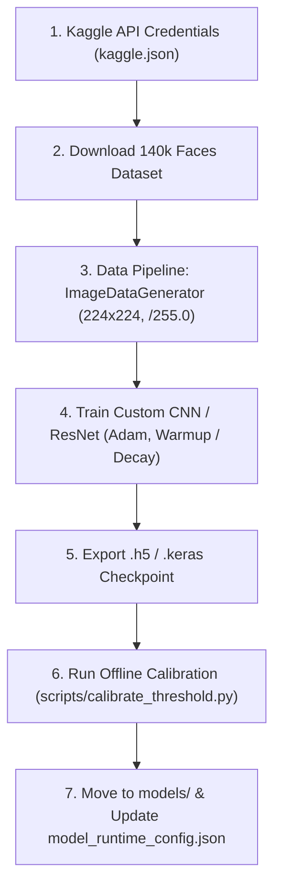

# Training: Reproduction Guide

> In this page: Step-by-step instructions for reproducing model training on Kaggle / Google Colab environments, notebook ordering, hyperparameters, seeds, and hardware requirements.  
> Who it's for: ML practitioners, researchers, and engineers fine-tuning custom models.

---

## Training Workflow Overview

Training in Guardian AI was developed and executed using Kaggle and Google Colab GPU runtimes. The visual models utilize TensorFlow/Keras with `ImageDataGenerator` data pipelines, while the speech anti-spoofing models utilize PyTorch and Colab GPU environments.



---

## 1. Visual Model Training (Kaggle Environment)

### Environment Prerequisites
- **Hardware**: NVIDIA Tesla T4 or P100 GPU (16 GB VRAM).
- **Environment**: Python 3.10+, TensorFlow 2.16.x, CUDA 12.x.

### Step 1: Dataset Acquisition
In a Kaggle or Colab notebook:
```bash
# Setup Kaggle API credentials
mkdir -p ~/.kaggle
cp kaggle.json ~/.kaggle/
chmod 600 ~/.kaggle/kaggle.json

# Download primary datasets
kaggle datasets download -d xhlulu/140k-real-and-fake-faces -p /content/dataset --unzip
kaggle datasets download -d ciplab/real-and-fake-face-detection -p /content/dataset --unzip
```

### Step 2: Training Execution
Execute either:
- **Notebook**: `docs/Deep-Fake-Detection-using-advanced-CNN-architectures-and-its-comparison-main/Model/DeepFake-CNN-Custom.ipynb`
- **Standalone Script**: `docs/Deep-Fake-Detection-using-advanced-CNN-architectures-and-its-comparison-main/Proposed_Custom_Hybrid-CNN(Optmized).py`

### Hyperparameters (Custom CNN 8-Epoch Run)
Derived directly from `Model/DeepFake-CNN-Custom.ipynb`:
- **Image Size**: $224 \times 224 \times 3$
- **Batch Size**: $32$
- **Total Epochs**: $8$
- **Steps per Epoch**: $3125$ ($\sim 100,000$ training images per epoch)
- **Optimizer**: Adam
- **Learning Rate Schedule**: Warmup scheduler:
  ```python
  def warmup(epoch):
      if epoch < 3:
          return 0.003
      else:
          return 0.001
  ```
- **Loss Function**: Binary Cross-Entropy (`loss='binary_crossentropy'`)
- **Metrics Tracked**: Accuracy, validation accuracy, ROC AUC, Average Precision (AP).

---

## 2. Acoustic Model Training

### Step 1: Dataset Acquisition
```bash
kaggle datasets download -d birdy654/deep-voice-deepfake-voice-recognition -p /content/dataset --unzip
```

### Step 2: Feature Extraction & Model Fitting
Execute `docs/Deep-Fake-Detection-using-advanced-CNN-architectures-and-its-comparison-main/Deepfake Voice Detection/deep_fake_voice_recognition.py`:
1. **Feature Extraction**: $40$-dimensional MFCCs extracted via `librosa.feature.mfcc(y, sr, n_mfcc=40)` and averaged over time or formatted as sequential frames with zero-padding ($max\_pad\_len=174$).
2. **Class Imbalance Handling**: Apply `RandomOverSampler(random_state=42)`.
3. **Model Selection**:
   - Multi-layer Dense Network ($128 \to 256 \to 128 \to 2$) with ReLU and Dropout ($0.5$).
   - Multi-Head Self-Attention Transformer model ($4$ heads, key dimension matching feature dimension).
   - Early stopping on validation loss (`monitor='val_loss', patience=10, restore_best_weights=True`).

---

## 3. Post-Training Calibration Workflow

Once weights are exported (e.g. `models/visual_model.h5`), calibrate the serving threshold:

```bash
# 1. Run local inference on a validation folder to produce score CSV
python scripts/generate_scores_local.py \
  --real-dir /path/to/validation/real \
  --fake-dir /path/to/validation/fake \
  --out calibration_scores.csv \
  --config model_runtime_config.json \
  --batch-size 64

# 2. Run threshold calibration sweep to maximize F1-score
python scripts/calibrate_threshold.py \
  --csv calibration_scores.csv \
  --out model_runtime_config.json
```
The script writes the optimal threshold directly into `model_runtime_config.json` and prints the resulting confusion matrix and F1 metric.
